Rapport de Projet de Fin d'Année (PFA)
Titre : Segmentation automatique et suivi cinétique de plaies (scratch assay) par
deep learning, avec interprétation assistée par LLM (RAG)

Parcours IA&DS

Établissement : EPI Digital School — École Internationale Supérieure Privée
Polytechnique de Sousse
Réalisé par : Karima Chiha
Année universitaire : 2026/2027
Lieu du stage : Laboratoire de Biologie, Faculté de Médecine et de Pharmacie
de Sousse

À COMPLÉTER PAR L'ÉTUDIANTE AVANT SOUMISSION : encadrant(s), logo de
l'établissement (page de garde).

---

> Note de méthode (à supprimer avant soumission) : ce brouillon est rédigé
> directement à partir du code, des tests et du `README.md` du projet — aucun
> chiffre, résultat ou architecture n'est inventé. Trois choses restent à
> votre charge avant de rendre le rapport : (1) les captures d'écran de
> l'application (marquées `[CAPTURE D'ÉCRAN]` ci-dessous), (2) les auteurs des
> articles cités en bibliographie (le corpus du projet ne stocke que
> titre/année/résumé, pas les auteurs — à récupérer sur Google
> Scholar/PubMed/arXiv avant de mettre en forme IEEE/APA), et (3) les éléments
> propres à votre parcours (dates, encadrant, contexte de stage/cours).

---

## Liste des abréviations

| Abréviation | Signification |
|---|---|
| API | Application Programming Interface (interface de programmation applicative) |
| BCE | Binary Cross-Entropy (entropie croisée binaire) |
| BM25 | Best Matching 25 (algorithme de pondération lexicale pour la recherche d'information) |
| CD | Déploiement Continu (Continuous Deployment) |
| CI | Intégration Continue (Continuous Integration) |
| CLAHE | Contrast Limited Adaptive Histogram Equalization |
| CNN | Convolutional Neural Network (réseau de neurones convolutif) |
| CPU | Central Processing Unit |
| CRISP-DM | Cross-Industry Standard Process for Data Mining |
| GPU | Graphics Processing Unit |
| IA | Intelligence Artificielle |
| IC | Intervalle de Confiance |
| IoU | Intersection over Union |
| JPEG | Joint Photographic Experts Group |
| LLM | Large Language Model (grand modèle de langage) |
| MAE | Mean Absolute Error (erreur absolue moyenne) |
| MLOps | Machine Learning Operations |
| MRR | Mean Reciprocal Rank |
| RAG | Retrieval-Augmented Generation (génération augmentée par récupération) |
| RGB | Red Green Blue (rouge-vert-bleu) |
| TTA | Test-Time Augmentation (augmentation au moment du test) |

---

## Résumé

Le scratch assay est une méthode in vitro largement utilisée pour étudier la migration
cellulaire et la fermeture de plaie, mais l'analyse quantitative des surfaces de plaie
reste généralement manuelle, ce qui la rend longue et sujette à variabilité. Ce projet
développe une solution basée sur l'intelligence artificielle pour la segmentation
automatique et l'analyse quantitative d'images de microscopie de scratch assay.

Un jeu de 97 images de microscopie, annotées par des contours de plaie tracés à la main,
a été transformé en masques binaires fiables via un pipeline de prétraitement dédié. Un
modèle U-Net à encodeur ResNet34 pré-entraîné a été entraîné sur un split
train/validation/test reproductible, puis évalué sur un jeu de test tenu à l'écart face
à une baseline classique (analyse de texture et seuillage d'Otsu). Un ensemble de
plusieurs modèles a également été étudié pour améliorer la robustesse et fournir un
signal de confiance au niveau du pixel, fondé sur l'accord entre modèles. Une
application Streamlit a été développée pour la segmentation automatique, la mesure, la
visualisation et la correction manuelle, complétée par un assistant à génération
augmentée par récupération (RAG) pour l'interprétation des résultats à la lumière de la
littérature.

Sur le jeu de test, le U-Net a obtenu un score de Dice de 0,882 contre 0,576 pour la
baseline, différence statistiquement significative (test de Wilcoxon, p = 0,000122). Un
ensemble de quatre modèles a par ailleurs obtenu un Dice de 0,893 sur ce même jeu de
test — un résultat exploratoire, deux des quatre modèles ayant partagé des données
d'entraînement avec cet échantillon —, le désaccord entre modèles étant néanmoins
corrélé négativement à la qualité de segmentation (r = -0,751) et offrant un signal de
confiance supplémentaire. Ces résultats montrent que l'approche proposée surpasse la
méthode classique testée, tout en reconnaissant explicitement ses limites et le besoin
de validation complémentaire.

**Mots-clés :** Scratch Assay, Deep Learning, Segmentation d'image, U-Net, Vision par
ordinateur, Cicatrisation, Génération augmentée par récupération (RAG)

## Abstract

The scratch assay is a widely used in-vitro method for studying cell migration and wound
closure, but the quantitative analysis of wound areas is typically performed manually,
making it time-consuming and subject to variability. This project develops an
artificial intelligence-based solution for automated segmentation and quantitative
analysis of scratch assay microscopy images.

A dataset of 97 microscopy images with manually drawn wound contours was processed into
reliable binary masks through a dedicated pipeline. A U-Net model with a pretrained
ResNet34 encoder was trained on a reproducible train/validation/test split and evaluated
on a held-out test set against a classical image-processing baseline (texture analysis
with Otsu thresholding). An ensemble of several models was also investigated to improve
robustness and provide a pixel-level confidence signal based on model agreement. A
Streamlit application was developed for automatic segmentation, measurement,
visualization, and manual correction, complemented by a retrieval-augmented generation
(RAG) assistant for literature-based interpretation of the results.

On the held-out test set, the U-Net achieved a Dice score of 0.882 versus 0.576 for the
baseline, a statistically significant difference (Wilcoxon signed-rank test,
p = 0.000122). A four-model ensemble further obtained a Dice score of 0.893 on this same
test set — an exploratory result, as two of the four models shared training data with
this sample —, with model disagreement correlating negatively with segmentation quality
(r = -0.751) and offering an additional confidence signal. These results show that the
proposed deep learning approach outperformed the tested classical method for wound
segmentation, while its limitations and the need for further validation are explicitly
acknowledged.

**Keywords:** Scratch Assay, Deep Learning, Image Segmentation, U-Net, Computer
Vision, Wound Healing, Retrieval-Augmented Generation (RAG)

---

## Introduction générale

L'analyse de la migration cellulaire et de la fermeture des plaies constitue un
aspect important de nombreuses études biologiques réalisées in vitro. Parmi
les méthodes utilisées pour étudier ces phénomènes, le *scratch assay*,
également appelé test de cicatrisation ou test de fermeture de plaie, est une
technique couramment employée pour évaluer la capacité des cellules à migrer
et à recouvrir progressivement une zone initialement dépourvue de cellules.
Cette évolution peut être suivie à différents instants à partir d'images
obtenues par microscopie, puis quantifiée à partir de la surface de la zone de
plaie.

Cependant, l'analyse quantitative des images de scratch assay est souvent
réalisée manuellement à l'aide d'outils de traitement d'images tels qu'ImageJ.
Cette approche nécessite notamment de délimiter la zone de la plaie et de
mesurer sa surface pour chaque image. Lorsque le nombre d'images augmente,
cette opération devient longue et dépendante de l'intervention de
l'utilisateur. Elle peut également introduire une certaine variabilité dans la
délimitation des contours. L'automatisation de cette étape représente donc un
intérêt pour faciliter l'analyse et améliorer sa reproductibilité.

Le choix de ce sujet s'inscrit dans la volonté d'appliquer les connaissances
acquises en intelligence artificielle et en Data Science à une problématique
concrète issue du domaine biologique. Ce projet offre ainsi l'opportunité de
mettre en pratique différentes compétences en traitement d'images, Deep
Learning, analyse de données et développement d'applications, tout en
répondant à un besoin d'automatisation identifié dans le cadre du stage.

Dans ce contexte, l'intelligence artificielle et plus particulièrement les
techniques de vision par ordinateur et de Deep Learning offrent des
possibilités pour automatiser la segmentation des régions d'intérêt dans les
images biologiques. Les réseaux de neurones dédiés à la segmentation, tels que
U-Net, permettent notamment d'identifier automatiquement les pixels
appartenant à une région donnée. Néanmoins, l'utilisation d'un modèle de Deep
Learning ne garantit pas à elle seule des résultats fiables. Il est nécessaire
d'évaluer ses performances sur des données indépendantes et de les comparer à
des méthodes classiques de traitement d'image afin de déterminer l'intérêt
réel de l'approche proposée.

La problématique de ce projet est donc la suivante : **comment automatiser la
segmentation et la quantification de la zone de plaie dans des images de
scratch assay à l'aide de techniques de Deep Learning, tout en évaluant leur
fiabilité par rapport à une méthode classique de traitement d'image ?**

L'objectif principal de ce projet est de développer une solution basée sur
l'intelligence artificielle permettant d'automatiser l'analyse des images de
scratch assay. Plusieurs objectifs spécifiques ont été définis : préparer et
contrôler les données ainsi que les annotations disponibles ; développer un
modèle de segmentation basé sur une architecture U-Net avec un encodeur
pré-entraîné ; évaluer ses performances sur un ensemble de test indépendant ;
comparer les résultats obtenus avec une approche classique basée sur l'analyse
de texture et le seuillage d'Otsu ; étudier l'utilisation de plusieurs modèles
afin d'améliorer la robustesse de la segmentation et de fournir un indicateur
de confiance ; et enfin, développer une application interactive permettant la
segmentation, la visualisation, la quantification et la correction manuelle
des résultats. Un assistant basé sur une approche de Retrieval-Augmented
Generation (RAG) est également intégré afin de faciliter l'interprétation des
mesures calculées à partir de la littérature scientifique. Cet assistant
intervient uniquement en aval du traitement et ne réalise ni segmentation, ni
calcul des mesures, ni diagnostic.

Pour conduire ce projet, une démarche structurée basée sur la méthodologie
**CRISP-DM** (*Cross-Industry Standard Process for Data Mining*) a été
adoptée. Elle permet d'organiser le travail autour de plusieurs étapes,
notamment la compréhension du problème, la compréhension et la préparation
des données, la modélisation, l'évaluation et la mise en œuvre de la solution
(voir 2.6 pour la correspondance détaillée entre ces phases et les chapitres
du rapport). Le projet suit également une démarche empirique et itérative :
les différentes décisions techniques sont évaluées à partir de mesures
quantitatives sur un jeu de données indépendant lorsque cela est possible. Les
résultats obtenus, y compris les limites et les résultats moins satisfaisants,
sont pris en compte afin d'éviter de retenir une approche uniquement sur la
base d'observations qualitatives.

Ce projet a été réalisé au sein du **Laboratoire de Biologie de la Faculté de
Médecine et de Pharmacie de Sousse**, situé à **Sousse, Tunisie**, dans le cadre d'un stage d'été en
intelligence artificielle et Data Science, sous la supervision de **[Nom du
superviseur]**. Le projet s'inscrit dans un contexte de recherche appliquée à
l'analyse d'images biologiques, à l'intersection entre les besoins d'un
laboratoire de recherche et les techniques d'intelligence artificielle.

Afin de présenter de manière progressive les différentes étapes du travail
réalisé, le rapport est organisé en cinq chapitres. Le **premier chapitre**,
consacré à l'état de l'art, présente le contexte biologique du scratch assay
ainsi que les principales approches utilisées pour l'analyse et la
segmentation des images, avec un intérêt particulier pour le Deep Learning,
l'architecture U-Net et les méthodes classiques de traitement d'image. Le
**deuxième chapitre**, consacré à l'analyse et aux spécifications, présente la
problématique, les objectifs, les données utilisées ainsi que la méthodologie
adoptée. Le **troisième chapitre** décrit la conception et l'implémentation de
la solution, notamment la préparation des données, le modèle de segmentation,
les améliorations étudiées, l'application Streamlit et l'assistant RAG. Le
**quatrième chapitre** présente le protocole d'évaluation, les métriques
utilisées, la comparaison avec l'approche classique ainsi que les résultats
expérimentaux et leur analyse. Enfin, le **cinquième chapitre** présente une
synthèse du travail réalisé, les principales limites rencontrées et les
perspectives d'amélioration.

---

## Chapitre 1 : État de l'art / Revue bibliographique

### 1.1 Introduction

Ce chapitre situe le projet par rapport à la littérature existante. Il
présente d'abord le scratch assay lui-même en tant que technique biologique
(1.2), puis les concepts fondamentaux d'intelligence artificielle et de
vision par ordinateur mobilisés (1.3). Les méthodes de traitement et de
segmentation d'image sont ensuite abordées, des approches classiques (1.4) —
seuillage d'Otsu, analyse de texture — aux méthodes par deep learning (1.5),
avec une attention particulière portée à l'architecture U-Net, au transfer
learning et à l'utilisation de ResNet34 comme encodeur, ainsi qu'aux
principales métriques utilisées pour évaluer une segmentation (1.6). Une revue des travaux
appliquant ces méthodes au scratch assay et à des problèmes biologiques
proches est ensuite proposée (1.7), complétée par les approches méthodologiques
non centrales à la segmentation mais mobilisées par le projet — ensemble de
modèles et RAG (1.8). Le chapitre se conclut par la justification des choix
techniques retenus (1.9), en préparation du Chapitre 2 qui détaille les
spécifications du projet lui-même. Conformément à l'usage, les résultats
chiffrés propres à ce projet ne sont pas présentés ici : ce chapitre décrit ce
que propose la littérature, le Chapitre 4 confronte ces repères aux résultats
réellement obtenus.

### 1.2 Le scratch assay : principe, protocole et limites

Le scratch assay, également appelé test de cicatrisation in vitro, est une
méthode expérimentale couramment utilisée pour étudier la migration et la
prolifération des cellules dans des conditions contrôlées. Cette approche
consiste à créer une zone dépourvue de cellules, appelée « scratch » ou zone
de plaie, au sein d'une monocouche cellulaire confluente, puis à suivre son
évolution au cours du temps par imagerie. La diminution progressive de cette
zone permet d'étudier la dynamique de fermeture et de quantifier indirectement
certains phénomènes liés à la migration cellulaire.

L'analyse du scratch assay repose généralement sur l'acquisition d'images à
différents instants après la création de la plaie. Ces images peuvent ensuite
être analysées afin d'estimer la surface de la zone non couverte par les
cellules et son évolution au cours du temps. La quantification de cette
évolution constitue ainsi un élément important pour comparer différentes
conditions expérimentales.

Malgré sa simplicité et son intérêt pour les études de migration cellulaire,
le scratch assay présente plusieurs sources de variabilité. La manière dont
la plaie est créée, les conditions de culture, la densité cellulaire,
l'acquisition des images et les méthodes utilisées pour délimiter la zone de
plaie peuvent notamment influencer les mesures obtenues. Ces variations
peuvent rendre la comparaison des résultats plus difficile et soulignent
l'importance de procédures d'acquisition et d'analyse aussi reproductibles
que possible.

Dans ce contexte, l'automatisation de l'analyse des images représente une
piste intéressante pour réduire la part des opérations manuelles et améliorer
la reproductibilité de la quantification. Les sous-sections suivantes
présentent le principe biologique du scratch assay, son protocole
expérimental, les méthodes de quantification de la fermeture ainsi que ses
principales limites et les approches proposées pour standardiser son
utilisation.

**1.2.1 Principe biologique.** Le *scratch assay* (ou *wound healing assay*,
test de cicatrisation) est un test in vitro qui consiste à créer
artificiellement, dans un tapis confluent de cellules adhérentes, une zone
linéaire dépourvue de cellules (la « rayure »), puis à observer sa
recolonisation progressive au cours du temps [13, 14]. La fermeture résulte
principalement de la migration collective des cellules bordant la zone, avec
une contribution possible de la prolifération cellulaire selon le type
cellulaire et la fenêtre d'observation [14]. Le test est utilisé aussi bien en
recherche fondamentale sur les mécanismes de migration qu'en criblage de
molécules à visée thérapeutique.

**1.2.2 Protocole expérimental et acquisition des images.** La rayure est
généralement créée à l'aide d'une pointe de micropipette raclée sur le tapis
cellulaire, puis la zone est imagée par microscopie à différents instants
(typiquement toutes les quelques heures) jusqu'à fermeture complète ou
quasi-complète [13, 14]. Chaque image constitue un instantané de la
progression de la fermeture, ce qui permet en principe une analyse aussi bien
ponctuelle (un instant donné) que temporelle (cinétique de fermeture sur
plusieurs instants).

**1.2.3 Méthodes de quantification de la fermeture.** La quantification
repose le plus souvent sur la mesure de la surface non colonisée à chaque
instant, rapportée à la surface initiale pour obtenir un pourcentage de
fermeture [9, 10], selon une relation de la forme :

$$\text{Fermeture (\%)} = \frac{S_0 - S_t}{S_0} \times 100$$

où $S_0$ représente la surface initiale de la plaie et $S_t$ sa surface à
l'instant $t$. Certains travaux vont plus loin en estimant une vitesse de
migration par intervalle de temps, ou en isolant la contribution de la
migration de celle de la prolifération par un suivi de particules ou de
trajectoires cellulaires individuelles plutôt qu'une seule mesure de surface
globale [11].

**1.2.4 Sources de variabilité et limites expérimentales.** Le scratch assay
est reconnu pour sa simplicité et son faible coût, mais aussi pour plusieurs
limites bien documentées [13, 18] : la largeur et la régularité de la rayure
dépendent fortement du geste de l'opérateur, ce qui introduit une variabilité
inter-opérateur difficile à contrôler ; le test ne mesure que la migration
collective planaire sur une surface plane et rigide, sans reproduire les
composantes inflammatoires, vasculaires ou matricielles d'une cicatrisation in
vivo ; enfin, la qualité de l'image (éclairage, contraste, mise au point)
affecte directement la fiabilité de toute mesure ultérieure, qu'elle soit
manuelle ou automatisée.

**1.2.5 Approches de standardisation.** Pour limiter la variabilité
opérateur-dépendante, plusieurs travaux proposent de standardiser la création
de la rayure elle-même plutôt que seulement son analyse : dispositifs
mécaniques ou robotisés reproduisant un geste identique d'un puits à l'autre,
gabarits ou peignes multi-pointes, protocoles normalisés d'acquisition
d'image [18]. Cette piste est complémentaire — et non concurrente — de
l'automatisation de l'analyse d'image visée par ce projet : elle agit en amont
(la qualité de la rayure produite), là où ce projet agit en aval (la mesure à
partir d'une image donnée, quelle que soit sa provenance).

### 1.3 Concepts fondamentaux de l'intelligence artificielle

**1.3.1 Intelligence artificielle et apprentissage automatique.**
L'intelligence artificielle désigne, au sens large, la conception de systèmes
capables de réaliser des tâches associées à l'intelligence humaine.
L'apprentissage automatique (*machine learning*) en est un sous-domaine dans
lequel le système n'est pas programmé explicitement pour la tâche, mais
apprend un modèle à partir de données.

**1.3.2 Apprentissage supervisé.** Dans l'apprentissage supervisé, le modèle
est entraîné à partir de paires (entrée, sortie attendue) fournies par des
exemples annotés — ici, des images de microscopie associées à leur masque de
segmentation de référence. C'est le cadre dans lequel s'inscrit la tâche
centrale de ce projet : une segmentation binaire (pixel « plaie » / pixel
« tapis cellulaire ») apprise à partir d'exemples annotés manuellement, et non
une classification d'image entière — la prédiction par pixel permet de
calculer directement une surface.

**1.3.3 Apprentissage non supervisé.** À l'inverse, l'apprentissage non
supervisé cherche à extraire une structure de données non annotées (par
exemple un regroupement par similarité). Il n'est pas utilisé pour la tâche de
segmentation elle-même dans ce projet, mais un principe apparenté — la
similarité entre représentations vectorielles (*embeddings*) sans étiquette
associée — sous-tend la recherche documentaire par similarité sémantique
utilisée par l'assistant RAG (voir 1.8.3).

**1.3.4 Deep Learning.** Le Deep Learning est une famille de méthodes
d'apprentissage automatique fondées sur des réseaux de neurones à plusieurs
couches, capables d'apprendre directement une représentation utile des données
brutes (ici, des pixels) sans extraction manuelle de descripteurs — par
opposition aux méthodes classiques de traitement d'image (voir 1.4), qui
reposent sur des descripteurs conçus a priori (seuils, textures).

**1.3.5 Vision par ordinateur.** La vision par ordinateur regroupe les
tâches visant à extraire une information utile d'une image ou d'une vidéo :
classification, détection d'objets, et la tâche mobilisée ici, la
segmentation — l'attribution d'une catégorie à chaque pixel de l'image.

### 1.4 Traitement et segmentation classique des images

**1.4.1 Prétraitement des images.** Avant toute segmentation, les images de
microscopie peuvent nécessiter un prétraitement : réduction du bruit,
correction du vignettage ou des inhomogénéités d'éclairage (*flat-field*),
amélioration locale du contraste (par exemple par égalisation d'histogramme
adaptative, CLAHE). Ces étapes visent à réduire la sensibilité des méthodes
d'analyse ultérieures aux conditions d'acquisition.

**1.4.2 Segmentation d'images.** La segmentation consiste à partitionner une
image en régions correspondant à des objets ou des zones d'intérêt. Selon la
finesse recherchée, on distingue notamment la segmentation par régions
(regroupement de pixels similaires) et la segmentation par contours
(détection des frontières entre régions).

**1.4.3 Segmentation sémantique.** La segmentation sémantique attribue une
classe à chaque pixel de l'image (ici, deux classes : « plaie » et « tapis
cellulaire »), par opposition à la segmentation d'instances qui distinguerait
en plus des occurrences individuelles d'un même objet — une distinction non
pertinente ici puisque la zone de plaie forme une seule région connexe.

**1.4.4 Méthodes classiques de segmentation.** Avant l'essor du deep
learning, la segmentation reposait sur des règles ou des descripteurs conçus
manuellement : seuillage global ou adaptatif de l'intensité, filtrage
morphologique, croissance de région, contours actifs, ou transformées par
ensembles de niveaux (*level-set*) pour détecter un contour même en conditions
de faible contraste.

**1.4.5 Seuillage d'Otsu et analyse de texture.** La méthode d'Otsu [21]
détermine automatiquement un seuil d'intensité qui maximise la séparation
entre deux classes de pixels, en minimisant la variance intra-classe. Elle
suppose implicitement que les deux classes se distinguent par leur intensité
— une hypothèse qui ne tient pas toujours pour le scratch assay, où la zone de
plaie se distingue du tapis cellulaire non par sa couleur mais par l'absence
de texture cellulaire (surface lisse contre surface grainée). Le seuillage
d'Otsu peut alors être appliqué non pas directement à l'image, mais à une
carte de texture dérivée (par exemple l'écart-type local de l'intensité, ou
des descripteurs de texture de type matrice de co-occurrence, GLCM) — une
combinaison largement documentée dans les outils historiques d'analyse du
scratch assay (voir 1.7.1).

### 1.5 Segmentation d'images par Deep Learning

La segmentation d'images constitue une tâche importante en vision par
ordinateur, particulièrement dans le domaine de l'imagerie biomédicale. Elle
consiste à attribuer une classe à chaque pixel d'une image afin d'identifier
et de délimiter les régions d'intérêt. Les méthodes de Deep Learning ont
progressivement amélioré les performances de segmentation grâce à leur
capacité à apprendre automatiquement des représentations adaptées aux
données. Dans le cadre de ce projet, une architecture U-Net associée à un
encodeur ResNet34 pré-entraîné est utilisée pour segmenter la zone de plaie
dans les images issues du scratch assay.

**1.5.1 Réseaux de neurones convolutifs.** Les réseaux de neurones
convolutifs (*Convolutional Neural Networks*, CNN) sont une famille de
réseaux de neurones particulièrement adaptée au traitement des images.
Contrairement aux méthodes reposant sur des descripteurs conçus manuellement,
les CNN apprennent automatiquement des caractéristiques à partir des données
d'entrée. Une couche de convolution applique plusieurs filtres sur l'image
afin d'extraire progressivement différentes caractéristiques visuelles : les
premières couches apprennent des éléments simples (contours, textures), les
couches plus profondes construisent des représentations plus complexes à
partir de ces caractéristiques élémentaires. Cette capacité d'apprentissage
hiérarchique rend les CNN particulièrement adaptés aux tâches de vision par
ordinateur, notamment la classification, la détection et la segmentation —
pour cette dernière, l'objectif n'est pas de déterminer la classe d'une image
entière, mais de produire une prédiction pour chaque pixel.

**1.5.2 Architecture U-Net.** U-Net [1] est une architecture de réseau de
neurones initialement conçue pour la segmentation d'images biomédicales.
Son architecture repose sur deux chemins complémentaires : un chemin
contractant permettant d'extraire les caractéristiques de l'image et un
chemin expansif permettant de reconstruire une carte de segmentation à une
résolution proche de celle de l'image originale. Une caractéristique
essentielle de U-Net est l'utilisation de connexions de saut (*skip
connections*) entre les niveaux correspondants des deux chemins, qui
permettent de transmettre au décodeur des informations spatiales provenant
de l'encodeur, notamment les détails fins nécessaires à la localisation
précise des frontières des régions segmentées. Cette architecture est
particulièrement intéressante pour les applications biomédicales, où la
délimitation précise des structures d'intérêt est importante et où la
quantité de données annotées peut être limitée. Dans ce projet, U-Net est
utilisé pour distinguer les pixels correspondant à la zone de plaie des
pixels appartenant au tapis cellulaire.

**1.5.3 Architecture encodeur-décodeur.** L'architecture U-Net peut être
considérée comme une architecture de type encodeur-décodeur. L'encodeur
constitue le chemin contractant du réseau : il réduit progressivement la
résolution spatiale de l'image tout en augmentant la richesse des
caractéristiques extraites, ce qui permet au réseau de construire une
représentation de plus en plus abstraite du contenu de l'image. Le décodeur
constitue le chemin expansif : il augmente progressivement la résolution des
représentations afin de produire une segmentation pixel par pixel. Les
connexions de saut entre l'encodeur et le décodeur permettent de combiner les
informations sémantiques extraites à basse résolution avec les informations
spatiales conservées à des résolutions plus élevées. Dans le contexte du
scratch assay, cette combinaison est importante car la segmentation doit
identifier la zone de plaie tout en conservant une délimitation suffisamment
précise de ses contours.

**1.5.4 Transfer Learning.** Le *Transfer Learning*, ou apprentissage par
transfert, consiste à réutiliser un modèle ayant déjà appris des
représentations sur une base de données source disposant de beaucoup de
données (typiquement une classification d'images naturelles sur ImageNet
[23]) afin de l'adapter à une nouvelle tâche ou à un nouveau domaine
disposant de peu de données. Cette approche est largement documentée en
imagerie biomédicale [4, 5] comme un moyen d'obtenir de bonnes performances
malgré un jeu d'entraînement réduit — la littérature met toutefois en garde
contre les jeux de données biomédicaux « imparfaits » (petits, bruités,
annotés de façon hétérogène), qui restent une contrainte à part entière même
avec un encodeur pré-entraîné [5]. Dans ce projet, cette approche permet de
bénéficier de représentations déjà apprises tout en adaptant le réseau aux
caractéristiques particulières des images de microscopie du scratch assay,
plutôt que d'entraîner l'encodeur entièrement à partir de zéro.

**1.5.5 ResNet34 comme encodeur.** ResNet34 [22] est une architecture de
réseau neuronal convolutionnel appartenant à la famille des réseaux résiduels
(*Residual Networks*). Elle utilise des connexions résiduelles permettant de
transmettre directement certaines informations à travers plusieurs couches du
réseau, ce qui facilite l'entraînement de réseaux relativement profonds et
contribue à limiter les problèmes liés à la dégradation des performances
lorsque la profondeur du réseau augmente. Utiliser un ResNet34 pré-entraîné
comme encodeur d'un U-Net, plutôt qu'un encodeur « maison » entraîné from
scratch, est une combinaison documentée dans plusieurs travaux de
segmentation biomédicale [3, 4]. Dans l'architecture utilisée dans ce projet,
ResNet34 est employé comme encodeur du U-Net : il est initialisé à partir de
poids pré-entraînés, puis adapté aux images de microscopie étudiées. Le choix
de ResNet34 constitue ainsi un compromis entre la capacité de représentation
du modèle et sa complexité, ce qui est pertinent dans le contexte d'un jeu de
données de taille limitée.

**1.5.6 Fonctions de perte pour la segmentation.** Lors de l'entraînement
d'un modèle de segmentation, une fonction de perte permet de mesurer l'écart
entre le masque prédit par le réseau et le masque de référence. Dans le cas
d'une segmentation binaire, l'entropie croisée binaire (BCE), calculée
indépendamment pour chaque pixel, constitue une fonction de perte couramment
utilisée, mais elle traite les pixels selon leur contribution individuelle à
la classification, ce qui peut la rendre moins adaptée aux situations de fort
déséquilibre entre les classes — une situation fréquente en
segmentation biomédicale, où l'objet d'intérêt (ici, la fine bande de plaie)
occupe une faible proportion de l'image. Pour améliorer la prise en compte du
chevauchement entre les régions prédites et les régions de référence, une
perte basée sur le coefficient de Dice (voir 1.6.1) peut également être
utilisée. Ce coefficient s'écrit de façon équivalente :

$$\text{Dice} = \frac{2\,TP}{2\,TP + FP + FN}$$

où $TP$ représente les vrais positifs, $FP$ les faux positifs et $FN$ les
faux négatifs. La *Dice Loss*, dérivée directement de ce coefficient,
pénalise le manque de recouvrement global entre prédiction et référence
plutôt que l'erreur pixel par pixel. Dans ce projet, les deux composantes
sont combinées afin de former une fonction de perte de type Dice + BCE, ce
qui permet de bénéficier à la fois d'un signal d'apprentissage stable au
niveau des pixels et d'une sensibilité au chevauchement global entre la zone
de plaie prédite et le masque de référence.

### 1.6 Évaluation des méthodes de segmentation

La littérature met en garde contre une évaluation naïve de la segmentation,
qui choisirait des métriques par habitude plutôt qu'en fonction du problème
posé [6, 7]. Les métriques suivantes sont les plus couramment utilisées pour
la segmentation binaire et sont, pour cette raison, retenues pour ce projet
(leur valeur mesurée sur ce projet est présentée au Chapitre 4, pas ici).

**1.6.1 Dice Score.** Le coefficient de Dice mesure le recouvrement entre le
masque prédit $P$ et le masque de référence $G$ : $\text{Dice} = \frac{2 |P
\cap G|}{|P| + |G|}$. Il varie de 0 (aucun recouvrement) à 1 (recouvrement
parfait) et pondère implicitement davantage les faux positifs/négatifs sur les
petits objets que sur les grands.

**1.6.2 Intersection over Union.** L'IoU (ou indice de Jaccard) mesure le
rapport entre l'intersection et l'union des deux masques : $\text{IoU} =
\frac{|P \cap G|}{|P \cup G|}$. Il est mathématiquement lié au Dice
($\text{IoU} = \text{Dice} / (2 - \text{Dice})$) mais pénalise
proportionnellement plus fortement les erreurs que le Dice.

**1.6.3 Précision et rappel.** La précision ($|P \cap G| / |P|$) mesure la
proportion de pixels prédits comme plaie qui le sont réellement ; le rappel
($|P \cap G| / |G|$) mesure la proportion de pixels réellement « plaie »
effectivement détectés. Un modèle peut obtenir un bon Dice tout en étant
déséquilibré entre les deux (par exemple, sur-segmenter légèrement pour
maximiser le rappel au prix de la précision) — d'où l'intérêt de les rapporter
séparément plutôt que de se limiter au Dice.

**1.6.4 Distance de Hausdorff.** Contrairement aux métriques précédentes,
fondées sur le recouvrement de surface, la distance de Hausdorff mesure un
écart de contour : la plus grande distance, parmi tous les points d'un
contour, à son point le plus proche sur l'autre contour. C'est une métrique de
pire cas, très sensible à un seul point de contour mal placé, même si le
recouvrement global est excellent par ailleurs [7]. L'article introduisant la
mesure *clDice* [8] propose une alternative topologique spécifiquement conçue
pour les structures fines et allongées (initialement les réseaux vasculaires),
une géométrie proche de celle d'une bande de plaie fine et longue.

**1.6.5 Erreur de surface.** Spécifique au cas d'usage biologique du scratch
assay, l'erreur de surface relative exprime directement l'écart de mesure
dans l'unité utile au biologiste (une surface, convertible en pourcentage de
fermeture), plutôt qu'un score de recouvrement abstrait :

$$\text{Erreur de surface (\%)} = \frac{|S_{\text{prédite}} - S_{\text{référence}}|}{S_{\text{référence}}} \times 100$$

où $S_{\text{prédite}}$ représente la surface calculée à partir du masque
prédit et $S_{\text{référence}}$ la surface obtenue à partir du masque de
référence. Plusieurs travaux de quantification du scratch assay rapportent
directement ce type d'erreur plutôt que le seul Dice [9, 10].

### 1.7 Travaux similaires et état de la recherche

**1.7.1 Automatisation de l'analyse du scratch assay.** Plusieurs outils
dédiés à l'analyse d'images du scratch assay sans recours au deep learning ont
été développés et restent utilisés en laboratoire. Parmi eux figurent le
plugin ImageJ *Wound Healing Size Tool*, l'outil *TScratch*, fondé sur une
transformée en curvelets [15], ainsi que *Fiji* [16], qui constitue une
plateforme généraliste d'analyse d'images biologiques. Des outils plus
spécifiquement automatisés, comme *AIM* [17], combinent le seuillage adaptatif
et des opérations de traitement morphologique afin de produire une mesure de
fermeture sans intervention manuelle répétée.

Ces outils restent appréciés pour leur simplicité et leur faible coût
computationnel, mais nécessitent généralement un réglage manuel de certains
paramètres et restent sensibles aux variations d'éclairage et de contraste.

**1.7.2 Segmentation biologique par Deep Learning.** Au-delà du scratch
assay, le U-Net et ses variantes, notamment U-Net++, ainsi que les
architectures intégrant des encodeurs pré-entraînés comme TernausNet [4], sont
largement utilisés pour la segmentation d'images biomédicales. Ces approches
sont particulièrement intéressantes dans des contextes où les données
annotées disponibles sont limitées [5], une contrainte également rencontrée
dans de nombreux problèmes d'imagerie biologique.

Le deep learning permet d'apprendre automatiquement des caractéristiques
pertinentes à partir d'images annotées, mais les performances obtenues
restent liées à la qualité et à la représentativité des données
d'apprentissage ainsi qu'à la capacité du modèle à généraliser à de nouvelles
images.

**1.7.3 Utilisation de U-Net dans l'analyse du scratch assay.** Deux
travaux directement pertinents pour ce projet ont été identifiés. Le
premier applique un U-Net à l'analyse du scratch assay sur un jeu de données
de plus de 400 images provenant d'un même laboratoire et rapporte un
coefficient de Dice compris entre 0,958 et 0,968 [2]. Le second applique une
architecture comparable, fondée sur un U-Net avec un encodeur pré-entraîné, à
des micrographies de cellules souches mésenchymateuses en contraste de phase.
Bien que cette application ne porte pas directement sur le scratch assay,
cette modalité d'imagerie présente certaines caractéristiques proches. Le
travail rapporte un Dice de 0,876 [3].

Un troisième travail combine une segmentation par U-Net++ avec différentes
méthodes de modélisation temporelle de la trajectoire de fermeture, notamment
les forêts aléatoires, ARIMA et un réseau convolutif temporel [12]. Par
ailleurs, un suivi de particules individuelles a également été proposé afin
d'analyser la cinétique de fermeture image par image [11].

**1.7.4 Comparaison des approches existantes.** Les résultats rapportés par
ces travaux dépendent de plusieurs facteurs, notamment de la taille et de
l'homogénéité du jeu de données d'entraînement, du protocole expérimental et
de la modalité d'imagerie. Le travail disposant de plus de 400 images
issues d'un protocole unique [2] rapporte un Dice sensiblement supérieur à
celui obtenu dans l'étude portant sur un domaine d'imagerie proche avec un jeu
de données plus restreint [3]. Toutefois, cet écart ne peut pas être attribué
uniquement à la taille du jeu de données, puisque les deux études diffèrent
également par leurs conditions expérimentales et leurs modalités d'imagerie.

Ces deux références constituent néanmoins des repères pertinents pour la
comparaison des performances et seront utilisées au Chapitre 4 afin de situer
les résultats obtenus dans le cadre de ce projet.

**1.7.5 Limites des travaux existants.** Peu de travaux identifiés couplent
une segmentation automatique à un suivi temporel multipoint de la fermeture,
par opposition à une mesure ponctuelle ou à une comparaison entre deux
instants [11, 12]. Par ailleurs, le travail directement consacré au
scratch assay [2] ne rapporte pas d'évaluation sur des images issues d'un
laboratoire ou d'un microscope différent de celui utilisé pour l'entraînement.
La question de la généralisation inter-laboratoire reste ainsi ouverte dans
ce domaine de recherche.

Ces limites motivent, dans le cadre de ce projet, l'utilisation d'un jeu de
test indépendant pour l'évaluation, la comparaison avec une méthode de
référence classique et l'étude d'approches complémentaires, notamment
l'ensemble de modèles et un indicateur d'incertitude, présentées dans la
section suivante.

### 1.8 Approches complémentaires

En complément des méthodes de segmentation présentées précédemment, certaines
approches peuvent être mobilisées afin d'améliorer la robustesse des
prédictions et de faciliter l'interprétation des résultats. Dans ce projet,
elles interviennent en complément du modèle principal de segmentation et
concernent l'utilisation d'un ensemble de modèles, un indicateur
d'incertitude ainsi que les approches fondées sur le Retrieval-Augmented
Generation (RAG) et les modèles de langage.

**1.8.1 Ensemble de modèles et amélioration de la robustesse.** Combiner
plusieurs modèles indépendants constitue une technique classique d'ensemble en
apprentissage automatique. Dans le cas de la segmentation d'images, les
prédictions de plusieurs modèles peuvent notamment être combinées par vote
majoritaire pixel par pixel. Cette stratégie permet de réduire la dépendance à
un modèle unique et peut améliorer la robustesse des prédictions lorsque les
modèles présentent des erreurs différentes.

La diversité entre les modèles peut notamment provenir de variations dans
leur initialisation ou dans les conditions d'apprentissage. Lorsque leurs
erreurs ne sont pas parfaitement corrélées, leur combinaison peut conduire à
une prédiction plus stable que celle d'un modèle individuel.

Dans le cadre de ce projet, plusieurs modèles entraînés avec des
initialisations différentes sont réutilisés afin de construire une prédiction
par ensemble. Les résultats expérimentaux associés à cette approche sont
présentés au Chapitre 4.

**1.8.2 Indicateur d'incertitude basé sur l'accord entre modèles.** Au-delà de
l'amélioration de la prédiction, le désaccord entre les modèles d'un ensemble
peut être exploité comme un indicateur d'incertitude par pixel. Lorsqu'une
majorité de modèles produit la même prédiction, l'accord est élevé. À
l'inverse, une divergence entre les modèles indique une région pour laquelle
la prédiction est moins stable.

Cette idée est utilisée dans différentes approches de quantification de
l'incertitude en imagerie médicale fondées sur le Deep Learning [19, 20]. Elle
permet notamment de compléter la prédiction binaire par une information
indiquant les régions où le modèle présente davantage d'incertitude.

Dans ce projet, le désaccord entre les modèles de l'ensemble est utilisé pour
produire une carte mettant en évidence les zones incertaines. La relation
entre ce signal de désaccord et les performances de segmentation est étudiée
expérimentalement au Chapitre 4.

**1.8.3 Retrieval-Augmented Generation (RAG).** Le Retrieval-Augmented
Generation (RAG) [24] est une approche qui combine un modèle de langage avec
un mécanisme de recherche dans une base documentaire. Les documents pertinents
sont récupérés en fonction de la question posée, notamment à l'aide de
représentations vectorielles (*embeddings*), puis fournis au modèle de
langage afin de générer une réponse contextualisée.

Cette approche permet d'ancrer les réponses dans un corpus documentaire
sélectionné plutôt que de dépendre uniquement des connaissances internes du
modèle de langage. Elle est ainsi particulièrement intéressante dans des
domaines scientifiques où les réponses doivent pouvoir être reliées à des
sources documentaires.

Dans le cadre de ce projet, le RAG est utilisé avec une base documentaire
locale regroupant des articles scientifiques relatifs à la cicatrisation et
au scratch assay. Il constitue une couche complémentaire destinée à fournir
au modèle de langage des informations issues de cette documentation.

**1.8.4 Utilisation des LLM pour l'interprétation scientifique.** Les grands
modèles de langage (*Large Language Models*, LLM) peuvent être utilisés pour
reformuler des résultats quantitatifs, répondre à des questions en langage
naturel et mettre en relation des observations avec des informations issues
de la littérature scientifique. Cependant, leur utilisation dans un contexte
scientifique nécessite de prendre en compte le risque de génération
d'informations incorrectes mais plausibles, souvent désigné sous le terme
d'*hallucination*.

Le RAG peut contribuer à limiter ce risque en fournissant au modèle des
documents pertinents servant de contexte, mais il ne garantit pas à lui seul
l'exactitude de toutes les réponses générées. Une séparation claire entre le
calcul des mesures et leur interprétation constitue donc une précaution
importante.

Dans ce projet, les mesures quantitatives sont calculées en amont par les
méthodes de traitement et d'analyse implémentées en Python. Le LLM intervient
ensuite pour faciliter l'interprétation textuelle de ces résultats, en
s'appuyant sur les documents récupérés par le système RAG. Les détails de
cette architecture et les mécanismes de contrôle mis en place sont présentés
au Chapitre 3.

### 1.9 Justification de l'approche adoptée

Les éléments présentés dans les sections précédentes permettent de justifier
les choix méthodologiques retenus pour répondre à la problématique du projet.
L'objectif n'est pas uniquement d'automatiser la mesure de la fermeture de la
plaie, mais de construire une approche capable de produire des segmentations
reproductibles, d'évaluer leur fiabilité et de faciliter l'interprétation des
résultats dans un contexte de recherche en biologie.

**1.9.1 Choix du Deep Learning.** La revue ci-dessus (1.4-1.5) montre que les
méthodes classiques de segmentation, bien qu'utiles et peu coûteuses,
reposent sur des descripteurs conçus a priori (intensité, texture) dont la
validité dépend fortement des conditions d'acquisition — une limite
directement pertinente pour un jeu d'images de microscopie aux conditions
d'éclairage variables. Le Deep Learning, en apprenant directement une
représentation à partir des données, est une réponse documentée à cette
limite dans le champ plus large de la segmentation biomédicale (1.7.2).

**1.9.2 Choix de U-Net et de ResNet34.** Le U-Net constitue une architecture
largement utilisée pour la segmentation biomédicale, notamment lorsque le
jeu de données annotées est de taille réduite (1.5.2), et les travaux
portant directement sur le scratch assay ou sur des modalités proches (1.7.3)
constituent des éléments en faveur de sa pertinence pour ce domaine précis.
Un encodeur ResNet34 pré-entraîné sur ImageNet, plutôt qu'un encodeur
entraîné *from scratch*, est cohérent avec la pratique documentée en
transfer learning biomédical (1.5.4, 1.5.5) — une pratique particulièrement
adaptée à un jeu de données d'entraînement de taille modeste (voir Chapitre
2, jeu de données).

**1.9.3 Intérêt de la comparaison avec une méthode classique.** Plutôt que de
supposer a priori la supériorité du Deep Learning, conserver une baseline
classique (seuillage sur une carte de texture, dans l'esprit des outils
historiques du domaine, 1.7.1) permet de mesurer objectivement l'apport réel
du Deep Learning pour ce projet précis, plutôt que de s'appuyer uniquement sur
des résultats publiés dans d'autres conditions (voir Chapitre 4).

**1.9.4 Intérêt de l'ensemble de modèles.** L'ensemble de modèles est motivé
par la volonté de réduire la dépendance à une seule initialisation et par
l'intérêt d'un indicateur de désaccord par pixel au-delà de la seule
prédiction binaire (1.8.2). Cette information est utile dans un outil destiné
à assister un biologiste, qui peut ainsi disposer d'une indication sur les
régions où les prédictions des modèles sont moins concordantes, plutôt que de
considérer la prédiction automatique comme infaillible.

**1.9.5 Intérêt du RAG pour l'interprétation scientifique.** Le choix d'un
RAG plutôt que d'un LLM seul pour l'interprétation des résultats découle
directement du risque de fabrication d'information documenté en 1.8.4 : ancrer
la réponse sur des extraits réellement récupérés est une réponse partielle
mais nécessaire à ce risque, ce qui a motivé le développement d'une
méthodologie de test spécifique pour cette partie du projet (voir Chapitre 3).

#### 1.9.6 Synthèse : solution proposée

Le tableau ci-dessous résume la position de la solution développée par
rapport aux approches présentées dans ce chapitre.

| Approche | Principe | Limites relevées |
|---|---|---|
| Mesure manuelle (ImageJ) | Tracé du contour et mesure de la surface image par image | Lente sur de nombreuses images, dépendante de l'opérateur |
| Outils classiques (Wound Healing Size Tool, TScratch, AIM) [15, 17] | Seuillage, texture ou curvelets, opérations morphologiques | Réglage manuel de paramètres, sensibilité à l'éclairage et au contraste |
| U-Net appliqué au scratch assay [2] | Segmentation par deep learning sur plus de 400 images | Pas d'évaluation rapportée sur un autre laboratoire ou microscope |
| **Solution proposée** | U-Net + ResNet34 pré-entraîné, comparé à une baseline classique ; carte de confiance par ensemble de modèles ; suivi temporel de la fermeture ; résumé scientifique assisté par RAG, avec synthèse vocale | Jeu de 97 images, pas de validation externe (voir Chapitre 5) |

### 1.10 Conclusion

Ce chapitre a présenté le scratch assay comme technique biologique, les
concepts d'intelligence artificielle et de segmentation mobilisés par le
projet, ainsi qu'une revue des travaux existants sur l'automatisation de son
analyse — qu'elle repose sur des méthodes classiques ou sur le Deep Learning.
Cette revue met en évidence à la fois l'intérêt du Deep Learning pour ce type
de tâche et les limites encore ouvertes du champ de recherche (généralisation
inter-laboratoire, suivi temporel multi-points), qui justifient les choix
techniques retenus pour ce projet. Le chapitre suivant précise, à partir de ce
cadre, la problématique, les objectifs et les spécifications concrètes du
projet.

---

## Chapitre 2 : Analyse et spécifications du projet

### 2.1 Définition du problème

Étant donné une série d'images de microscopie d'un même scratch assay prises à
différents instants, le système doit produire automatiquement :
1. le masque binaire de la zone non colonisée (la « plaie ») pour chaque
   image ;
2. la surface correspondante (en pixels², convertible en cm² si un ratio de
   calibration est fourni) ;
3. le pourcentage de fermeture par rapport à l'instant initial, ainsi que son
   évolution au fil des différents instants observés ;
4. un résumé scientifique en langage naturel de cette évolution, replacé dans
   le contexte de la littérature scientifique pertinente.

### 2.2 Objectifs fonctionnels

- Segmenter une image de scratch assay et en extraire la surface non
  colonisée.
- Permettre une correction manuelle du masque (suppression de fragments,
  correction au pinceau) lorsque la prédiction automatique est imparfaite.
- Suivre plusieurs images d'une même série temporelle et calculer l'évolution
  de la fermeture.
- Comparer un masque prédit à un masque de référence (métriques de qualité).
- Générer un résumé scientifique de l'évolution observée, appuyé sur une
  base documentaire.
- Permettre au biologiste d'écouter le résumé scientifique (synthèse
  vocale), par exemple pendant une manipulation au laboratoire, sans avoir à
  le relire à l'écran.
- Fournir un indicateur d'incertitude basé sur l'accord entre modèles (option
  d'ensemble de modèles), pour signaler à l'utilisateur les zones de
  désaccord entre modèles plutôt que de présenter un résultat unique sans
  indication de fiabilité.

### 2.3 Objectifs non fonctionnels

- **Reproductibilité** : split d'entraînement/validation/test fixé par graine
  aléatoire, expériences tracées (MLflow), résultats de robustesse
  inter-seed mesurés plutôt que supposés.
- **Fonctionnement local / sans dépendance externe payante** : le LLM tourne
  en local via Ollama, sans appel à une API propriétaire facturée à l'usage —
  contrainte pertinente pour un usage académique ou en laboratoire sans
  budget API dédié.
- **Fiabilité de la génération de texte** : aucune valeur numérique
  présentée au biologiste ne doit être calculée ou modifiée par le LLM — un
  objectif non fonctionnel central du projet, traité comme une contrainte
  d'architecture (voir Chapitre 3) plutôt que comme une simple bonne pratique
  de prompt.
- **Utilisabilité** : interface graphique (Streamlit) ne nécessitant aucune
  compétence en programmation de l'utilisateur final (biologiste).
- **Portée clairement délimitée** : outil de quantification pour la
  recherche in vitro, explicitement non destiné à un usage diagnostique ou
  clinique (voir Chapitre 5, limites).

### 2.4 Jeu de données

- **Source** : 97 images de microscopie de scratch assay.
- **Annotation** : chaque image est annotée manuellement par un contour tracé
  à la main directement sur la photographie ; ces annotations ne constituent
  pas directement des masques binaires exploitables par le modèle.
- **Préparation** : un script dédié reconstruit les masques binaires à partir
  de ces contours tracés à la main : détection du trait par couleur/teinte,
  pontage des discontinuités du trait (effacé par endroits à cause de la
  compression JPEG), fermeture morphologique sur les bords d'image, puis
  remplissage par *flood-fill* de la zone délimitée.
- **Nettoyage** : une image est exclue du jeu de données final, son tracé
  manuel étant incomplet même après ce traitement.
- **Split** : séparation reproductible (graine fixée) en 68 images
  d'entraînement, 14 de validation, 14 de test. Le jeu de test est tenu à
  l'écart aussi bien de l'entraînement que de la sélection du meilleur
  modèle (contrairement au jeu de validation), afin que l'évaluation finale
  fournisse une estimation indépendante des performances de généralisation.
- **Variables/format** : images RGB de microscopie (résolution native
  variable selon l'image), masques binaires de même résolution. Pour la
  fonctionnalité de suivi temporel, chaque image analysée peut être
  associée à un instant d'observation exprimé en heures, déduit du nom de
  fichier ou fourni explicitement, ainsi qu'à un identifiant d'image. Ces
  informations sont utilisées pour organiser le suivi et calculer
  l'évolution de la fermeture, et ne constituent pas des variables
  d'entrée du modèle de segmentation.

### 2.5 Méthode d'analyse (pipeline global)

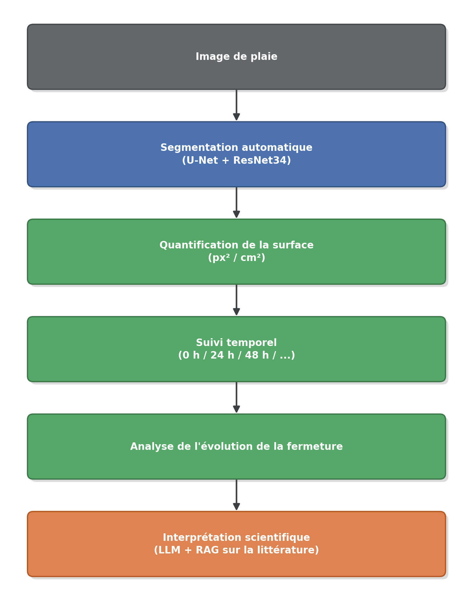

Le pipeline est volontairement stratifié en couches distinctes, chacune ayant
une responsabilité clairement définie :

1. **Couche vision** : produit automatiquement, à partir de l'image
   d'entrée, un masque de segmentation évalué par des métriques d'image
   classiques (Chapitre 4). Une option d'ensemble de modèles permet
   également d'obtenir un indicateur d'incertitude fondé sur le désaccord
   entre les prédictions.
2. **Couche quantification** : transforme ce masque en grandeurs numériques
   (surface, pourcentage de fermeture, évolution entre les instants),
   calculées uniquement en code (Python), jamais par le LLM.
3. **Couche interprétation** : reçoit ces grandeurs déjà calculées en entrée,
   puis les met en forme et les contextualise, sans effectuer elle-même de
   calcul numérique ; des mécanismes de contrôle visent à limiter la génération de
   valeurs non présentes dans les données calculées (voir Chapitre 3.4).
4. **Couche présentation** : interface Streamlit reliant les trois couches
   précédentes pour l'utilisateur final.

La figure 2.1 présente l'architecture générale du système et met en évidence
la séparation entre ces différentes couches fonctionnelles.

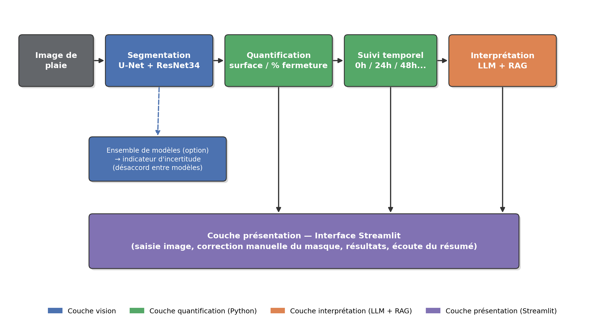

**Figure 2.1 — Architecture générale du système proposé.** Le diagramme
reprend la stratification en quatre couches décrite ci-dessus : la couche
vision produit le masque de segmentation (complétée par l'ensemble de
modèles, qui fournit un indicateur d'incertitude par désaccord) ; les couches
quantification et interprétation transforment puis contextualisent ces
résultats sans jamais se substituer l'une à l'autre ; la couche présentation
(Streamlit) est le seul point de contact avec l'utilisateur final.

### 2.6 Méthodologie de conduite du projet : cadre CRISP-DM

Au-delà du pipeline technique décrit en 2.5, la conduite du projet dans son
ensemble a suivi le cadre **CRISP-DM** (*Cross-Industry Standard Process for
Data Mining*), une méthodologie standard de conduite de projet de science des
données en six phases. Le tableau ci-dessous fait correspondre chaque phase à
son contenu concret dans ce projet et au chapitre qui la détaille :

| Phase CRISP-DM | Contenu du projet | Détaillé en |
|---|---|---|
| **1. Compréhension du métier** | Remplacer le tracé manuel du scratch assay, lent et peu reproductible, par une mesure automatique ; évaluer si le deep learning apporte un gain réel par rapport à une méthode classique ; fournir une interprétation scientifique prudente des résultats, sans jamais se substituer au biologiste | Introduction générale ; 2.1–2.3 |
| **2. Compréhension des données** | 97 images de microscopie de scratch assay, annotées par un contour tracé à la main (pas un masque directement exploitable) ; 48 articles scientifiques sélectionnés manuellement pour la base documentaire du RAG | 2.4 ; 3.4 |
| **3. Préparation des données** | Reconstruction des masques binaires à partir des contours tracés (détection de trait, pontage des discontinuités, remplissage) ; exclusion d'une image à l'annotation incomplète ; split reproductible train/val/test (68/14/14) ; augmentation de données à l'entraînement ; curation et traçabilité des décisions d'inclusion/exclusion des articles du corpus documentaire | 2.4 ; 3.3 |
| **4. Modélisation** | U-Net + encodeur ResNet34 pré-entraîné, entraînement en deux phases, perte Dice+BCE ; baseline classique de comparaison (seuillage de texture) ; ensemble de 4 modèles indépendants ; Test-Time Augmentation ; architecture LLM/RAG à deux appels séparés (mesures / littérature) | 3.1–3.2, 3.4 |
| **5. Évaluation** | Métriques de recouvrement et d'erreur de surface sur un jeu de test tenu à l'écart ; test de significativité de Wilcoxon et intervalle de confiance bootstrap ; étude de robustesse inter-seed ; analyse d'erreur qualitative et quantitative par catégorie ; benchmark de retrieval documentaire ; tests de régression sur la fiabilité de la génération LLM ; vérification de la synthèse vocale dans le navigateur | Chapitre 4 |
| **6. Déploiement** | Application Streamlit en deux onglets, avec synthèse vocale du résumé, utilisable sans compétence de programmation ; conteneurisation Docker ; registre de modèles MLflow avec promotion opt-in par comparaison de Dice, sans échec de l'entraînement en cas de problème de registre ; intégration continue (tests + build Docker + test de fumée) — sans déploiement automatisé réel, portée volontairement limitée | 3.6 ; Chapitre 5 (limites) |

**Nature itérative de la démarche.** Contrairement à une application linéaire
et unique de ces six phases, plusieurs cycles ont été nécessaires en pratique
— en particulier entre modélisation et évaluation (l'étude de robustesse
inter-seed et l'ensemble de modèles ont été ajoutés après une première
évaluation ayant révélé l'instabilité du Hausdorff, voir Chapitre 4), et entre
préparation des données et évaluation côté RAG (l'élargissement ciblé du
corpus documentaire, voir 3.4, a été motivé par des lacunes de retrieval
constatées lors de l'évaluation). Cette itération répétée entre phases,
plutôt qu'un enchaînement strictement séquentiel, est elle-même conforme à
l'esprit de CRISP-DM, qui présente ce cycle comme itératif et non linéaire.

### 2.7 Organisme d'accueil et planification du stage

**Organisme d'accueil.** Le stage s'est déroulé au sein du **Laboratoire de
Biologie de la Faculté de Médecine et de Pharmacie de Sousse** (Tunisie). Le
laboratoire mène des expériences in vitro, dont des scratch assays suivis par
microscopie, et a fourni le jeu de 97 images annotées utilisé dans ce projet
[41]. Le besoin exprimé était de réduire le temps passé à délimiter et
mesurer manuellement la zone de plaie sur chaque image, tout en conservant un
contrôle visuel du résultat. *(À COMPLÉTER : axes de recherche du
laboratoire, équipe, rôle du superviseur.)*

**Planification.** La figure ci-dessous présente le déroulement du projet.
Les dates sont reconstituées à partir de l'historique des versions du code
(git) et des dates de création des fichiers de données et de résultats, et
non d'un planning prévisionnel. Plusieurs phases se chevauchent, conformément
au caractère itératif de la démarche CRISP-DM décrit ci-dessus : l'évaluation
a par exemple conduit à ajouter l'étude multi-graines et l'ensemble de
modèles, et le travail sur le RAG s'est poursuivi pendant le développement de
l'application.

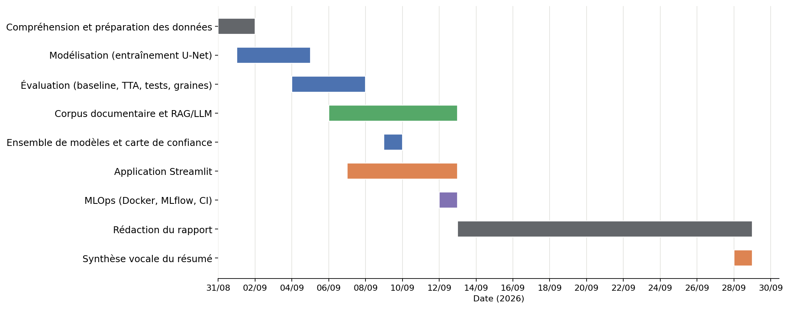

### 2.8 Conclusion

Ce chapitre a permis de définir le problème traité, les objectifs
fonctionnels et non fonctionnels du système, ainsi que les données utilisées
et leur préparation. L'architecture générale du pipeline a également été
présentée, en distinguant les différentes couches consacrées à la
segmentation, à la quantification, à l'interprétation et à la présentation
des résultats.

La démarche CRISP-DM adoptée pour la conduite du projet a enfin permis de
structurer les différentes étapes du développement tout en conservant une
approche itérative. Ces éléments constituent la base nécessaire à la
conception et à l'implémentation détaillée du système, présentées dans le
chapitre suivant.

## Chapitre 3 : Conception et implémentation du système

### 3.1 Architecture du système

**Architecture générale.** Le système suit la stratification en quatre
couches déjà présentée au Chapitre 2 (vision, quantification, interprétation,
présentation ; voir 2.5) : chaque couche correspond ici à un ou plusieurs
modules concrets du dépôt.

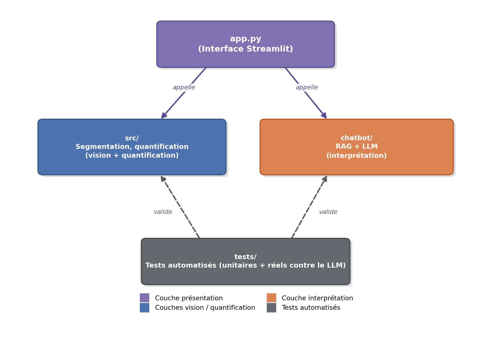

**Modules du système.**

| Module | Rôle | Fichiers clés |
|---|---|---|
| `src/` | Préparation des données, modèle, entraînement, évaluation, mesure, cinétique | `model.py`, `train.py`, `dataset.py`, `evaluate.py`, `measure.py`, `kinetics.py`, `baseline.py`, `ensemble.py` |
| `chatbot/` | Assistant IA (RAG) : recherche documentaire, génération de résumé, contrôles après génération | `chatbot.py`, `index_articles.py`, `evaluate_retrieval.py` |
| `app.py` | Interface utilisateur (Streamlit, deux onglets, synthèse vocale du résumé) | — |
| `tests/` | Tests automatisés (unitaires + réels contre le LLM) | `test_measure.py`, `test_metrics.py`, `test_ensemble.py`, `test_chatbot_*.py` |

**Interactions entre les modules.** `app.py` orchestre les trois autres
modules pour l'utilisateur final : il appelle `src/` pour la segmentation et
la quantification (couches vision et quantification), puis `chatbot/` pour
l'interprétation scientifique (couche interprétation), en ne lui transmettant
que des grandeurs déjà calculées (voir 3.4). `tests/` valide indépendamment
`src/` et `chatbot/`, y compris par des tests réels contre le LLM local (voir
3.4).

**Technologies et outils utilisés.** Python, avec les bibliothèques
principales suivantes : `torch` / `torchvision`, `segmentation-models-pytorch`,
`albumentations`, `opencv-python`, `streamlit` (+ `streamlit-drawable-canvas`,
`streamlit-image-coordinates`), `chromadb` et `rank_bm25` (recherche
documentaire), `ollama` (client LLM local), synthèse vocale native du
navigateur (Web Speech API, sans bibliothèque supplémentaire), `mlflow` (suivi d'expériences),
`pytest` (tests). L'entraînement et le suivi d'expériences utilisent MLflow
(métriques par époque, checkpoints et logs sauvegardés comme artefacts pour
chaque run), avec une intégration continue (tests automatisés) sur GitHub
Actions à chaque modification du code (voir 3.6).

**Configuration de l'environnement.** Le développement, l'entraînement et les
évaluations ont été réalisés sur un poste unique, décrit ci-dessous.
L'entraînement utilise automatiquement le GPU lorsqu'il est disponible
(`src/train.py`), sinon le CPU ; l'image Docker, elle, est volontairement
limitée au CPU (voir 3.6). Le fichier `requirements.txt` ne fige pas les
versions : celles du tableau sont les versions installées et vérifiées sur ce
poste.

| Élément | Version / caractéristique |
|---|---|
| Système d'exploitation | Windows 11 (64 bits) |
| Processeur | Intel Core i5-12450HX (12e génération) |
| Mémoire vive | 16 Go |
| Carte graphique | NVIDIA GeForce RTX 2050 (CUDA 12.4 via PyTorch) |
| Langage | Python 3.11.9 |
| Deep learning | PyTorch 2.6.0, torchvision 0.21.0, segmentation-models-pytorch 0.5.0 |
| Données et images | albumentations 2.0.8, OpenCV 4.13.0, NumPy 2.4.6, Pillow 12.2.0 |
| Statistiques et figures | SciPy 1.16.3, Matplotlib 3.10.9 |
| Recherche documentaire | ChromaDB 1.5.9, rank_bm25 0.2.2 |
| Modèle de langage local | Ollama 0.34.4 (serveur), client Python ollama 0.6.2, modèle Mistral 7B |
| Interface | Streamlit 1.57.0, streamlit-drawable-canvas 0.9.3, streamlit-image-coordinates 0.4.1 |
| Suivi d'expériences et tests | MLflow 3.16.0, pytest 9.1.1 |

**Expériences réalisées.** Toutes les expériences d'entraînement ont été
tracées dans MLflow (hyperparamètres, métriques par époque, checkpoint et
journal d'entraînement sauvegardés comme artefacts). Quatre entraînements
complets ont été menés avec la même configuration (encodeur ResNet34, images
384 × 384) : le run de référence, puis trois graines différentes pour l'étude
de robustesse et l'ensemble de modèles (Chapitre 4).

| Run | img_size | Époques | Train / Val | Meilleur Dice (val.) |
|---|---:|---:|---|---:|
| `unet_resnet34_holdout` | 384 | 60 | 68 / 14 | 0,923 |
| `unet_resnet34_seed42` | 384 | 60 | 68 / 14 | 0,921 |
| `unet_resnet34_seed123` | 384 | 60 | 68 / 14 | 0,923 |
| `unet_resnet34_seed2026` | 384 | 58 (arrêt anticipé) | 68 / 14 | 0,914 |

### 3.2 Conception et implémentation de la segmentation

**Modèle : U-Net avec encodeur ResNet34.** Encodeur pré-entraîné sur ImageNet
(bibliothèque `segmentation_models_pytorch`), une seule classe de sortie
(plaie / non-plaie), 3 canaux d'entrée (RGB) :

```python
def build_model(encoder_name="resnet34", encoder_weights="imagenet"):
    return smp.Unet(
        encoder_name=encoder_name,
        encoder_weights=encoder_weights,
        in_channels=3,
        classes=1,
    )
```

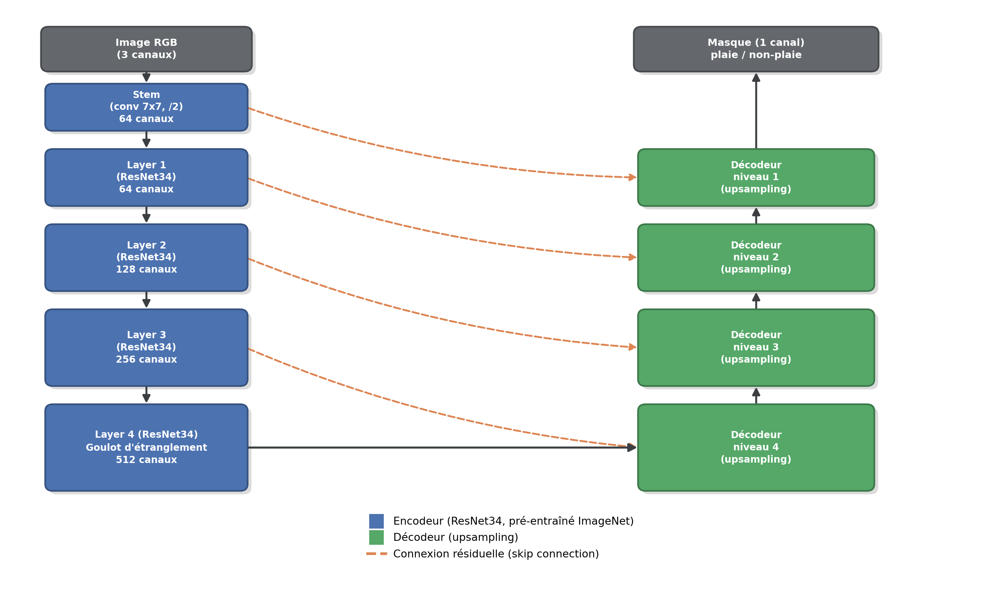

**Prétraitement des images.** Un prétraitement optionnel est proposé côté
application (débruitage, correction de champ plat / *flat-field*,
égalisation d'histogramme adaptative CLAHE), activable par l'utilisateur
avant prédiction. À l'entraînement, l'image est redimensionnée via le
pipeline d'augmentation de données (voir 3.3), et non par un simple
redimensionnement déterministe ; l'évaluation, elle, est effectuée en
résolution native : le masque prédit est ré-suréchantillonné à la résolution
originale avant comparaison, pour refléter exactement ce que voit
l'utilisateur final dans l'application plutôt qu'un score optimiste obtenu à
basse résolution.

**Reconstruction des masques.** Les masques de vérité terrain utilisés pour
l'entraînement sont reconstruits à partir des contours tracés à la main sur
les photographies (voir 3.3 pour le détail du traitement).

**Fonction de perte (Dice + BCE).** Combine une perte de recouvrement (Dice,
adaptée aux masques très déséquilibrés fond/plaie) et une perte de
classification pixel par pixel (entropie croisée binaire) :

$$\mathcal{L} = \mathcal{L}_{BCE} + (1 - \text{Dice})$$

```python
class DiceBCELoss(torch.nn.Module):
    def __init__(self):
        super().__init__()
        self.bce = torch.nn.BCEWithLogitsLoss()

    def forward(self, logits, target):
        bce = self.bce(logits, target)
        probs = torch.sigmoid(logits)
        pred = probs.flatten(1)
        tgt = target.flatten(1)
        intersection = (pred * tgt).sum(1)
        dice = (2 * intersection + EPS) / (pred.sum(1) + tgt.sum(1) + EPS)
        return bce + (1 - dice.mean())
```

**Entraînement en deux phases** (`src/train.py`). L'encodeur pré-entraîné est
d'abord gelé pendant 5 époques (seul le décodeur apprend, pour ne pas
détruire les poids ImageNet avec un signal de gradient encore bruité), puis
dégelé avec un taux d'apprentissage réduit d'un facteur 10 pour affiner
l'ensemble du réseau.

**Hyperparamètres.**

| Hyperparamètre | Valeur |
|---|---:|
| Époques (maximum) | 60 |
| Taille de batch | 4 |
| Taille d'image | 384 × 384 |
| Taux d'apprentissage initial | 1×10⁻⁴ |
| Époques encodeur gelé (warmup) | 5 |
| Patience (early stopping sur Dice val.) | 15 |
| Fonction de perte | Dice + BCE (voir ci-dessus) |
| Ordonnanceur de LR | `ReduceLROnPlateau` |

**Early stopping.** L'entraînement s'arrête automatiquement si le Dice sur le
jeu de validation ne s'améliore plus pendant 15 époques consécutives, afin
d'éviter le surapprentissage sur un jeu d'entraînement de taille modeste
(68 images) plutôt que de fixer arbitrairement un nombre d'époques.

Les courbes d'apprentissage, qui permettent de vérifier que le modèle
converge sans signe évident de surapprentissage, sont présentées et analysées au Chapitre 4
(section 4.2).

**Ensemble de modèles et Test-Time Augmentation.** Au-delà du modèle
canonique, `src/ensemble.py` recombine par vote majoritaire pixel par pixel
les prédictions de plusieurs modèles indépendants déjà entraînés (voir 1.8.1,
1.9.4), et produit une carte du nombre de modèles en désaccord par pixel,
utilisée comme indicateur d'incertitude. La Test-Time Augmentation moyenne
les probabilités prédites sur plusieurs versions retournées de l'image avant
seuillage. Les deux approches sont évaluées et comparées au Chapitre 4 ; ce
chapitre-ci ne décrit que leur implémentation, pas leurs performances.

### 3.3 Préparation et traitement des données

- **Dataset** : 97 images de microscopie de scratch assay (voir 2.4 pour la
  source et le contexte).
- **Génération des masques à partir des contours** : un script dédié
  reconstruit les masques binaires à partir des contours tracés à la main
  directement sur les photographies : détection du trait par couleur/teinte,
  pontage des discontinuités du trait (effacé par endroits à cause de la
  compression JPEG), fermeture morphologique sur les bords d'image, puis
  remplissage par *flood-fill* de la zone délimitée.
- **Nettoyage** : une image est exclue du jeu de données final, son tracé
  manuel étant incomplet même après ce traitement (voir 2.4).
- **Split train/validation/test** : séparation reproductible (graine fixée)
  en 68 images d'entraînement, 14 de validation, 14 de test, le jeu de test
  étant tenu à l'écart de la sélection du meilleur modèle (voir 2.4).
- **Augmentation des données** (bibliothèque `albumentations`, à
  l'entraînement uniquement) : recadrage aléatoire, retournements, ajout de
  bruit — pour compenser la taille réduite du jeu d'entraînement.

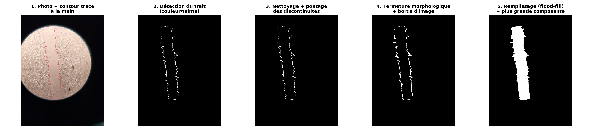

### 3.4 Composante RAG/LLM

**Corpus documentaire.** La base documentaire du RAG regroupe 48 articles
scientifiques relatifs à la cicatrisation et au scratch assay, sélectionnés
manuellement (voir 1.8.3, 2.6). Les documents sont indexés dans **ChromaDB**,
interrogée par similarité sémantique (*embeddings*) et complétée par une
recherche lexicale **BM25** (`rank_bm25`), pour combiner rapprochement par
sens et correspondance de termes exacts lors du *retrieval*. Le modèle de
langage est servi en local via **Ollama** (modèle **Mistral 7B**), sans appel
à une API propriétaire (voir 2.3).

Au-delà de ce mécanisme de récupération documentaire, ce point mérite une
sous-section dédiée : la fiabilité de la génération par LLM est la contrainte
de conception la plus spécifique de ce projet, largement au-delà d'un simple
appel à une API de LLM.

**Architecture à deux appels séparés.** Le résumé scientifique de cinétique
est construit par **deux appels indépendants** au LLM local :
1. Un premier appel reçoit uniquement les mesures déjà calculées par le
   pipeline (surface, %, évolution entre instants — voir 3.5) — jamais
   d'extrait d'article.
2. Un second appel reçoit uniquement des extraits d'articles scientifiques
   pertinents — jamais aucune mesure.

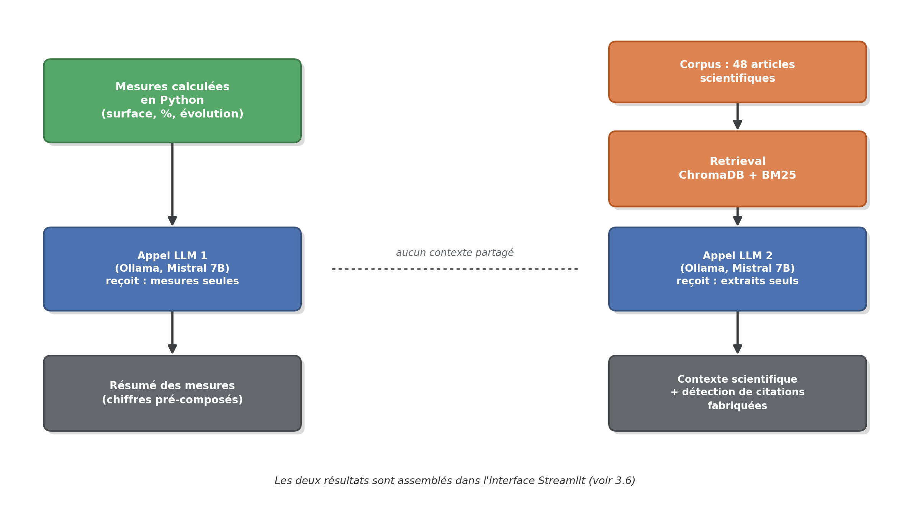

Cette séparation empêche directement le LLM de recevoir, dans un même appel,
à la fois les mesures expérimentales et les extraits documentaires : la
séparation des deux types de contexte est ainsi assurée au niveau de
l'architecture, plutôt que simplement recommandée par une consigne de
prompt.

**Calcul en Python, jamais par le LLM.** Toutes les valeurs numériques
présentées (moyennes, évolutions entre instants, comparaison entre
intervalles) sont calculées par du code Python pur et injectées déjà
calculées dans le prompt ; le LLM est chargé de les restituer et de les
mettre en forme, sans être responsable de leur calcul. Ce choix résulte
d'observations expérimentales répétées au cours du projet : lorsque le calcul
ou la comparaison de chiffres était laissé au modèle de langage local utilisé
(Mistral 7B), des erreurs apparaissaient régulièrement — y compris lorsqu'un
patron de phrase explicite lui était fourni pour le faire (bornes
d'intervalles inversées, signe négatif fabriqué ou omis). La solution
retenue n'a donc pas été de renforcer la consigne de prompt outre mesure,
mais de déplacer ces opérations hors du modèle : chaque phrase comparative
est entièrement pré-composée par du code Python, que le LLM est chargé de
reproduire sans la recalculer.

**Détection de citations fabriquées.** Un contrôle *a posteriori*, purement
programmatique, compare chaque titre d'article cité entre guillemets par le
LLM aux titres réellement retournés par la recherche documentaire pour cette
génération (comparaison approchée par distance d'édition, pour tolérer des
variantes mineures de recopie). Toute citation ne correspondant à aucun titre
réel est signalée à l'utilisateur.

**Autres contrôles après génération.** Sur le même principe (lecture du texte
déjà généré, sans modifier ni le prompt ni le contexte), d'autres contrôles
déterministes sont appliqués avant affichage : remplacement des références par
position (« le premier article ») par le vrai titre de l'article ; suppression
d'une phrase de consigne interne que le modèle recopie parfois dans le résumé ;
correction d'une faute d'accord récurrente dans la phrase de clôture ; et
avertissement lorsque le résumé affirme une augmentation de la surface de
plaie alors qu'aucune réouverture n'apparaît dans les mesures.

**Méthodologie de test dédiée.** Chaque modification du prompt ou du contenu
de la base documentaire est validée par un test d'isolation : plusieurs
générations réelles sont produites avant et après la modification et
comparées, plutôt que de supposer qu'une modification du texte d'instruction
suffit à changer le comportement du modèle. Cette méthodologie a permis
d'identifier et de corriger plusieurs défauts qui n'auraient pas été détectés
par une simple relecture du prompt (voir Chapitre 4.5).

Cette méthodologie a notamment révélé, à plusieurs reprises, une limite
structurelle de l'approche par prompt : une reformulation jugée meilleure en
moyenne lors d'un test d'isolation peut laisser subsister un défaut déjà
connu par ailleurs, ou en révéler un nouveau non détecté lors d'une
validation précédente. Dans chaque cas, la correction retenue n'a pas été de
renforcer indéfiniment la consigne — au risque de déstabiliser d'autres
parties du prompt, comme observé à plusieurs reprises sur ce projet — mais un
contrôle déterministe en aval, cohérent avec le principe déjà énoncé plus
haut. Les défauts concrets identifiés par cette méthodologie, ainsi que leur
correction, sont présentés au Chapitre 4.5.

### 3.5 Quantification et analyse temporelle

**Calcul de la surface.** La surface de la plaie est obtenue en comptant les
pixels du masque prédit appartenant à la classe « plaie » (`wound_area_px`,
`src/measure.py`) — une simple somme sur le masque binaire, sans hypothèse
supplémentaire sur la forme de la région.

**Calibration pixels/cm.** Lorsqu'un ratio pixels/cm est disponible (mesuré
manuellement sur un objet de référence visible dans l'image, ou fourni
explicitement), la surface en pixels² est convertie en cm² par
`area_px_to_cm2` ; sans cette calibration, seule la surface en pixels² (et le
pourcentage de fermeture, sans unité) est disponible.

**Pourcentage de fermeture.** Pour une série d'images d'un même échantillon
prises à différents instants, la fermeture à l'instant $t$ est calculée par
rapport à la surface de référence $S_0$ (le premier instant de la série,
généralement 0 h) :
$$\text{Fermeture}(t)\ (\%) = 100 \times \frac{S_0 - S_t}{S_0}$$
(`src/kinetics.py`) — cette formule est la même que celle documentée dans la
littérature (voir 1.2.3), appliquée ici à des surfaces issues de la
segmentation automatique plutôt que d'un tracé manuel.

**Évolution entre les différents instants.** Les images d'une même série
sont triées par temps croissant, et la fermeture est calculée pour chaque
instant par rapport à cette même référence $S_0$ — ce qui donne une évolution
de la fermeture au fil des instants observés, plutôt qu'une vitesse de
fermeture entre deux instants consécutifs (voir 2.1, qui précise cette même
distinction).

**Génération du résumé à partir des valeurs calculées.** Les grandeurs
calculées ici (surface, pourcentage de fermeture, évolution temporelle) sont
exactement celles transmises au premier appel LLM décrit en 3.4 ; leur
génération en résumé scientifique, et les mécanismes de contrôle associés,
sont détaillés dans cette même section 3.4 plutôt que répétés ici.

### 3.6 Interface et aspects MLOps

**Interface Streamlit.** L'application (`app.py`) propose deux onglets :
« Analyse d'une image » pour la segmentation, la mesure et la correction
manuelle d'une image unique, et « Suivi de cicatrisation » pour le calcul de
la cinétique de fermeture sur une série d'images et la génération du résumé
scientifique assisté par LLM. Un chat interactif, qui mélangeait mesures et
extraits d'articles dans un même appel au LLM, figurait dans une version
antérieure ; il a été retiré de l'application pour cette raison.

**Synthèse vocale du résumé.** Une fois le résumé scientifique généré, un
bouton « Écouter le résumé » permet de l'entendre lu à voix haute, et un
bouton « Arrêter » d'interrompre la lecture. La solution retenue est la
synthèse vocale intégrée au navigateur (Web Speech API) plutôt qu'une
bibliothèque Python : elle ne demande aucune dépendance supplémentaire ni
connexion Internet, s'exécute sur le poste de l'utilisateur avec les voix du
système (voix française sous Windows), et évite les problèmes de blocage
connus des moteurs de synthèse appelés depuis un serveur Streamlit. Avant la
lecture, la mise en forme Markdown du résumé (titres, gras, puces) est
retirée pour ne pas être prononcée, et le texte est transmis au navigateur
sous forme de chaîne encodée, pour qu'un contenu inattendu ne puisse pas être
interprété comme du code. Cette fonctionnalité est purement
présentationnelle : elle lit le texte déjà affiché, après les contrôles
décrits en 3.4, sans modifier ni les mesures ni le résumé. Elle a été
vérifiée dans le navigateur : lecture en français, balises Markdown absentes
du texte prononcé, et contenu piégé lu littéralement sans erreur.

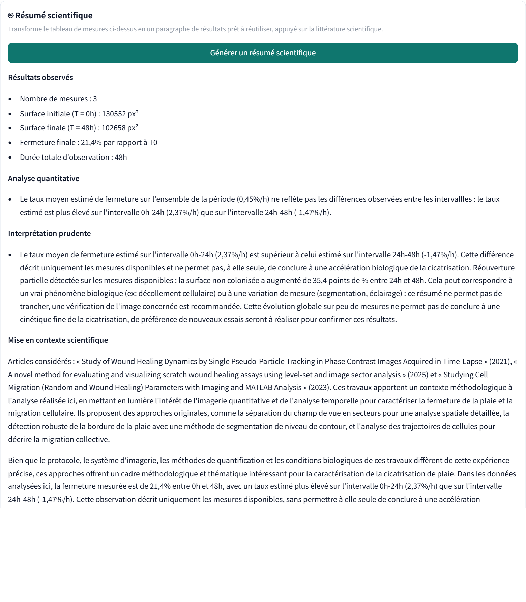

**Correction manuelle du masque.** Le contour détecté par le modèle n'est pas
toujours parfait : l'utilisateur peut dessiner, au pinceau (largeur
réglable), une zone à ajouter à la plaie (tracé vert) ou à retirer (tracé
magenta) par-dessus le masque prédit — l'intérieur du tracé est rempli
automatiquement pour éviter un contour dédoublé. Une option permet également
d'ignorer entièrement la prédiction du modèle et de tracer la plaie à la main
(`streamlit-drawable-canvas`).

Au-delà du script d'entraînement et de l'application Streamlit, le projet met
en place une première couche d'outillage MLOps, avec une portée délibérément
limitée (voir 2.3, objectifs non fonctionnels, et Chapitre 5, limites) : il ne
s'agit pas de construire un pipeline de déploiement continu complet, mais de
rendre l'environnement reproductible et les modèles versionnés.

**Conteneurisation (Docker).** L'application (Streamlit + dépendances Python)
est packagée dans une image Docker CPU-only (les wheels PyTorch CPU sont
installées explicitement, pour éviter de télécharger les dépendances CUDA
inutiles en l'absence de GPU dans l'image). Un service Ollama séparé est
orchestré via `docker-compose.yml`, avec les données volumineuses
(images, sorties, index documentaire) montées en volumes plutôt qu'intégrées à
l'image. Un `HEALTHCHECK` interroge l'endpoint de santé natif de Streamlit
pour signaler la disponibilité réelle du service, pas seulement le démarrage
du conteneur.

**Registre de modèles (MLflow Model Registry).** Le script d'entraînement peut
enregistrer le meilleur checkpoint comme nouvelle version versionnée d'un
modèle nommé dans le registre MLflow (option `--register_model`, désactivée
par défaut, et sans échec de l'entraînement en cas de problème de registre).
Une règle de promotion, volontairement simple, compare le Dice de validation
de la nouvelle version à celui de la version actuellement marquée comme
version de production (via un alias MLflow, pas les « stages » dépréciés) :
la nouvelle version n'est promue que si elle obtient un Dice strictement
supérieur, ou si aucune version n'est encore en production. Un échec du
registre (indisponibilité, permissions) est capturé et journalisé sans jamais
interrompre l'entraînement lui-même — l'enregistrement du modèle reste une
fonctionnalité annexe, pas une dépendance critique du pipeline
d'apprentissage.

**Intégration continue (CI).** Le dépôt GitHub exécute, à chaque modification
de code, la suite de tests automatisés puis la construction de l'image Docker,
suivie d'un test de fumée qui vérifie que les dépendances de l'image
s'importent réellement (pas seulement que la construction de l'image
réussit).

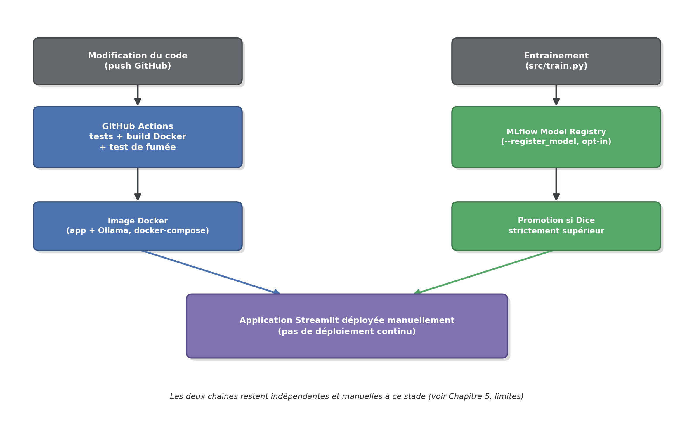

**Limites du déploiement.** Il s'agit d'intégration continue au sens strict —
garantir que le code et l'image restent valides — et non de déploiement
continu : aucune publication d'image ni déploiement automatisé n'a lieu à ce
stade (voir Chapitre 5, limites).

### 3.7 Conclusion

Ce chapitre a décrit comment le système présenté au Chapitre 2 a été
concrètement construit : l'architecture logicielle et ses modules, la
conception et l'implémentation du modèle de segmentation, la préparation des
données d'entraînement, la composante RAG/LLM et ses mécanismes de fiabilité,
le calcul des grandeurs de quantification et de suivi temporel, ainsi que
l'interface utilisateur et les premiers éléments d'outillage MLOps.

Conformément à la distinction déjà posée aux chapitres précédents, les
résultats chiffrés obtenus avec cette implémentation — comparaison du modèle
de segmentation à la baseline classique, apport de l'ensemble de modèles et
de la TTA, performance du RAG — ne sont pas présentés ici : ils font l'objet
du chapitre suivant, consacré à l'évaluation et à l'expérimentation.

---

## Chapitre 4 : Évaluation et expérimentation

### 4.1 Métriques d'évaluation utilisées

Pour une tâche de segmentation binaire, l'accuracy pixel par pixel est peu
informative (les masques sont très déséquilibrés : la plaie occupe une faible
part de l'image) et n'a volontairement pas été retenue comme métrique
principale. Les métriques utilisées sont :

- **Dice** (équivalent du F1-score pour des masques binaires) et **IoU**
  (Intersection-over-Union) — métriques de recouvrement, les plus pertinentes
  pour ce projet.
- **Precision** et **Recall** — pour caractériser le type d'erreur dominant
  (sur-segmentation vs sous-segmentation).
- **Distance de Hausdorff normalisée** (rapportée à la diagonale de l'image,
  pour rester comparable entre images de résolutions différentes) — métrique
  de pire cas, sensible à un seul point de contour mal placé.
- **Erreur de surface** (absolue en px² et relative en %) — la métrique la
  plus directement interprétable pour un biologiste, puisqu'elle porte sur la
  grandeur finalement utilisée (surface de plaie).

### 4.2 Résultats obtenus


**Qualité de l'entraînement : le modèle apprend-il correctement ?** Les deux figures ci-dessous montrent l'évolution
de la perte et du Dice sur les jeux d'entraînement et de validation (le jeu
de test n'est pas suivi époque par époque : il n'est évalué qu'une fois, sur le modèle retenu).
La convergence est régulière, et les courbes ne
montrent pas de signe évident de surapprentissage sur la période observée : le Dice de validation ne décroche pas de celui
d'entraînement. Il lui est même supérieur tout au long de l'entraînement, ce
qui est attendu ici : l'augmentation de données forte appliquée à
l'entraînement (recadrage aléatoire, retournements, bruit) rend la tâche plus
difficile que sur la validation, qui ne subit qu'un redimensionnement. Le
meilleur checkpoint (époque 54, Dice de validation 0,923) est retenu selon ce
critère.


**Comparaison U-Net vs baseline classique** (14 images de test, jamais vues à
l'entraînement) :

| Méthode | Dice | IoU | Precision | Recall | Hausdorff normalisé | MAE surface (px²) | Erreur de surface relative |
|---|---:|---:|---:|---:|---:|---:|---:|
| Texture + Otsu (baseline) | 0,576 | 0,448 | 0,558 | 0,817 | 0,204 | 210 243 | 404,9 % |
| **U-Net + ResNet34** | **0,882** | **0,796** | **0,852** | 0,929 | 0,323 | **8 538** | **15,9 %** |

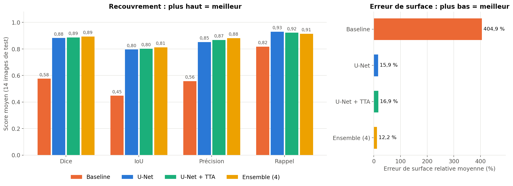

Le U-Net domine largement sur les métriques de recouvrement et surtout sur
l'erreur de surface (15,9 % contre 405 % pour la baseline). Le Hausdorff
normalisé du U-Net est en revanche plus élevé (moins bon) que celui de la
baseline malgré un Dice très supérieur — un résultat contre-intuitif rapporté
sans le masquer, analysé ci-dessous (TTA et robustesse inter-seed). Ce résultat montre qu'une métrique prise
isolément ne suffit pas à caractériser la qualité d'une segmentation : le
Dice et l'IoU décrivent principalement le recouvrement global des régions,
tandis que la distance de Hausdorff est particulièrement sensible à des
écarts localisés du contour.

**Test-Time Augmentation (TTA)** — moyenner les probabilités prédites sur 4
versions retournées de l'image avant seuillage fait chuter le Hausdorff
normalisé de 0,323 à 0,043, suggérant que le Hausdorff élevé provient en
partie d'artefacts de contour isolés plutôt que d'une dégradation globale du
recouvrement. Ce
gain n'est cependant pas généralisable à toutes les métriques : le Dice reste
quasi inchangé (0,882 → 0,886) et l'erreur de surface se dégrade légèrement
(15,9 % → 16,9 %). La TTA améliore donc spécifiquement la stabilité du
contour, sans réduction de l'erreur de surface — c'est l'ensemble de modèles
(ci-dessous) qui obtient la meilleure performance globale parmi les variantes
évaluées.

**Ensemble de 4 modèles + carte de confiance** — les 4 modèles indépendants
déjà entraînés (le run canonique + les 3 graines de l'étude de robustesse)
sont combinés par vote majoritaire pixel par pixel ; le nombre de modèles en
désaccord à chaque pixel fournit une carte de confiance exploitable
directement par l'utilisateur.

**Limite méthodologique importante.** Les graines 123 et 2026 utilisées ici
reposent, comme détaillé dans « Robustesse inter-seed » ci-dessous, sur un
split train/validation/test régénéré indépendamment du split canonique. En
pratique, chacune des 14 images du jeu de test canonique a été vue, en
entraînement ou en validation, par le modèle seed 123, par le modèle
seed 2026, ou par les deux — aucune des 14 images n'est restée non vue par
ces deux modèles simultanément. Le tableau ci-dessous ne peut donc pas être
interprété comme une performance de test indépendante au même titre que la
comparaison U-Net/baseline ci-dessus : il documente le comportement observé
de cette combinaison de modèles sur cet échantillon précis, à titre
exploratoire, et non un gain de performance validé sur données non vues.

| Métrique | Modèle unique | Ensemble (4 modèles, résultat exploratoire) |
|---|---:|---:|
| Dice | 0,882 | 0,893 |
| IoU | 0,796 | 0,812 |
| Precision | 0,852 | 0,881 |
| Recall | 0,929 | 0,915 |
| Hausdorff normalisé | 0,323 | 0,038 |
| Erreur de surface relative | 15,9 % | 12,2 % |

Sous cette réserve, la carte de confiance reste une fonctionnalité à part
entière de l'application, indépendamment de la validité du chiffre de Dice
ci-dessus : elle signale à l'utilisateur les zones où les modèles de
l'ensemble ne s'accordent pas, quelle que soit la performance exacte mesurée
sur cet échantillon. La corrélation observée entre le pourcentage de zone en
désaccord entre modèles et le Dice par image (−0,751) doit être lue avec la
même réserve méthodologique, puisqu'elle est calculée à partir de ce même
jeu de prédictions. La figure ci-dessous représente cette relation image par image : les
images au-delà du seuil d'alerte de l'application (25 %) sont bien celles
dont le Dice est le plus faible.

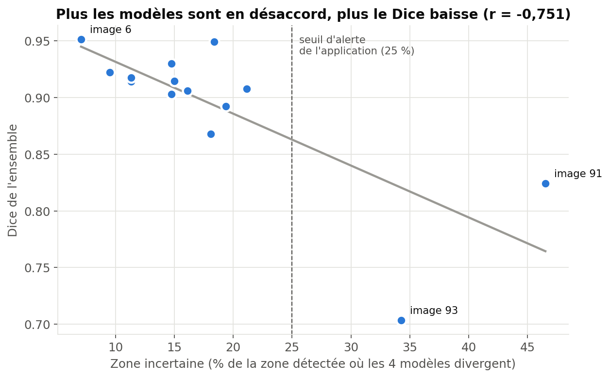

**Illustration concrète (deux cas réels du jeu de test, à titre
exploratoire).** Pour rendre ce chiffre tangible, deux images de test aux
profils opposés sont comparées ci-dessous (carte de confiance : vert = les 4
modèles d'accord, rouge = désaccord partiel) :

| | Image 6 (faible incertitude) | Image 91 (forte incertitude) |
|---|---|---|
| Zone incertaine | 7,1 % | **46,5 %** (> seuil d'alerte de l'application, 25 %) |
| Dice | 0,951 | 0,824 |
| Erreur de surface | 5,0 % | 21,4 % |


Sur l'image 6, une plaie franche et continue : les 4 modèles s'accordent
presque partout, la zone incertaine reste sous les 10 % et le Dice dépasse
0,95. Sur l'image 91, une plaie quasi refermée et fragmentée en plusieurs
îlots disjoints : les modèles divergent sur près de la moitié de la zone
détectée, l'application déclenche son avertissement de vérification manuelle,
et le Dice chute à 0,824 — exactement la relation statistique mesurée
ci-dessus, observée ici sur un exemple concret plutôt que sur une moyenne.
Ce contraste illustre l'utilité pratique de l'indicateur pour le biologiste :
il ne se contente pas d'annoncer une surface, il signale aussi quand cette
surface mérite une vérification visuelle avant d'être réutilisée.


**Robustesse inter-seed** — le même protocole d'entraînement a été répété sur
3 graines aléatoires indépendantes pour vérifier que le résultat ne tient pas
à un split ou une initialisation favorable. La graine ne contrôle pas
uniquement l'initialisation du modèle : elle contrôle aussi, via
`src/split_data.py`, la génération du split train/validation/test lui-même.
Les graines 123 et 2026 régénèrent donc un split entièrement différent du
split canonique (seule la graine 42 coïncide avec le split canonique, ce
dernier ayant été généré avec cette même valeur par défaut) ; les quatre
modèles comparés ici (canonique compris) sont par ailleurs quatre
entraînements indépendants, jamais une réutilisation du même checkpoint :

| Seed | Dice | IoU | Erreur de surface | Hausdorff normalisé |
|---|---:|---:|---:|---:|
| 42 | 0,880 | 0,791 | 16,1 % | 0,083 |
| 123 | 0,903 | 0,828 | 7,2 % | 0,131 |
| 2026 | 0,892 | 0,809 | 8,8 % | 0,032 |
| **moyenne ± écart-type** | **0,892 ± 0,009** | **0,809 ± 0,015** | **10,7 % ± 3,9 %** | **0,082 ± 0,040** |

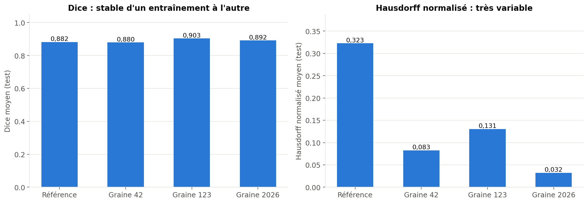

Le Dice reste relativement stable malgré les variations de graine et de
découpage des données observées dans cette expérimentation. Ce résultat
suggère une certaine robustesse de la performance aux variations du
protocole de séparation et de l'initialisation. Il ne permet toutefois pas
de conclure à une robustesse générale, notamment en l'absence de validation
externe. Le Hausdorff, en revanche, varie fortement (presque ×4 entre
graines), confirmant qu'il ne doit pas être lu comme un score de qualité
stable pour cette tâche.

### 4.3 Comparaison de différents modèles/paramètres et significativité statistique

Au-delà de la comparaison de moyennes, un test des rangs signés de Wilcoxon
(non paramétrique, adapté à un petit échantillon) a été appliqué aux paires
**(U-Net, baseline classique)** sur le Dice et sur l'IoU de chacune des 14
images de test (comparaison appariée image par image, script
`src/statistical_comparison.py`), complété par un intervalle de confiance
bootstrap (10 000 ré-échantillonnages) sur la différence moyenne :

| Métrique | Moyenne U-Net | Moyenne baseline | Diff. moyenne | U-Net meilleur sur | p (Wilcoxon) | IC bootstrap 95 % |
|---|---:|---:|---:|---:|---:|---:|
| Dice | 0,882 | 0,576 | +0,307 | 14/14 images | 0,000122 | [+0,183 ; +0,448] |
| IoU | 0,796 | 0,448 | +0,348 | 14/14 images | 0,000122 | [+0,236 ; +0,470] |

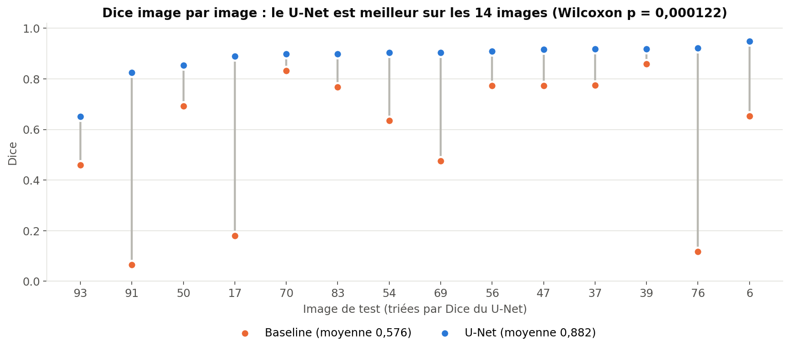

Image par image, aucun segment ne descend : le U-Net est au-dessus de la
baseline pour chaque image. Sur le Dice et sur l'IoU, le U-Net obtient un score supérieur à la baseline
classique sur les 14 images de test sans exception, ce qui produit le p le
plus faible que ce test puisse atteindre à cette taille d'échantillon
(largement < 0,05) : **la supériorité du U-Net sur la baseline classique**
(et non sur l'ensemble de modèles ou une autre variante) est statistiquement
significative sur cet échantillon. Cette comparaison ne porte que sur
U-Net vs baseline ; les gains de la TTA (4.2) sont rapportés comme des
moyennes sur le même jeu de test, sans test de significativité dédié à ce
stade, et ceux de l'ensemble de modèles (4.2) le sont à titre exploratoire
compte tenu de la limite méthodologique déjà signalée sur les splits.
Réserve méthodologique : un échantillon de 14 images reste
petit pour généraliser au-delà de ce jeu de test précis — réserve que
l'étude de robustesse inter-seed (4.2, Dice = 0,892 ± 0,009 sur 3 graines)
vient partiellement contrebalancer, en montrant que le résultat ne tient pas
à un split ou une initialisation favorable.

Les comparaisons de paramètres/configurations réalisées sont : modèle unique
vs ensemble de 4 modèles (4.2), avec vs sans TTA (4.2), et robustesse sur 3
graines d'initialisation différentes (4.2) — un seul jeu d'hyperparamètres
d'entraînement (encodeur, taille d'image, taux d'apprentissage) a été exploré
à ce stade (voir Chapitre 5, perspectives).

### 4.4 Analyse critique des résultats


**Cas qualitatifs représentatifs** (figure ci-dessus, quatre cas : image
originale / vérité terrain / U-Net / baseline) : sur un cas de bonne
segmentation, les deux méthodes suivent le contour mais la baseline ajoute du
bruit ; sur un cas difficile, le U-Net reste précis quand la baseline se
fragmente ; sur un cas d'échec de la baseline (éclairage atypique, fond
grisâtre plutôt que rose), le U-Net suit correctement le contour quand la
baseline dérive et trace presque tout le pourtour du champ — illustrant
concrètement la fragilité d'une méthode de seuillage classique face à des
conditions d'acquisition variables.

**Analyse d'erreur quantitative par catégorie** — pour vérifier avec des
chiffres (pas seulement sur les cas illustrés) l'hypothèse de fragilité de la
baseline à l'éclairage, les images de test ont été croisées avec un critère
objectif de luminosité (z-score par rapport au dataset complet) :

| Éclairage (test, n) | Dice U-Net | Dice baseline |
|---|---:|---:|
| Normal (12) | 0,884 | 0,656 |
| Atypique (2) | 0,874 | **0,092** |

Sur les images à éclairage atypique, le U-Net reste stable quand la baseline
s'effondre. Ces résultats sont compatibles avec l'hypothèse d'une plus grande
sensibilité de la baseline aux variations d'éclairage ; toutefois, compte
tenu du faible nombre d'images atypiques (n = 2), cette observation doit être
considérée comme une tendance exploratoire plutôt que comme une conclusion
statistiquement établie. **Avertissement méthodologique explicite** : avec
seulement 14 images de test, chaque catégorie ne contient que 1 à 13 images ;
ce tableau sert à confirmer une tendance déjà observée qualitativement, pas à
établir un résultat statistique à part entière.

**Cas limite documenté** : l'image obtenant le pire score des deux méthodes
correspond à la plus petite surface de plaie de tout le dataset (rang 1/97,
1,3 % du champ). Sur une structure aussi fine, quelques pixels d'écart de
contour suffisent à faire chuter fortement des métriques proportionnelles à la
surface (Dice/IoU) — une limite connue et mesurable sur les plaies quasi
refermées, partagée par les deux méthodes, et non un échec de généralisation
isolé. La figure ci-dessous montre cette tendance sur les 14 images de test :
le Dice du U-Net diminue pour les plaies de très petite surface relative. Avec
seulement 14 points, il s'agit d'un signal cohérent à garder en tête pour les
plaies quasi refermées, pas d'une relation statistique démontrée.


**Mise en regard avec la littérature (Chapitre 1)** : le Dice de 0,882 obtenu
ici, sur seulement 97 images, est cohérent avec un comparateur indépendant sur
une modalité d'imagerie proche (Dice 0,876, cellules souches mésenchymateuses
[3]) mais nettement inférieur à un comparateur direct sur scratch assay
disposant de plus de 400 images (Dice 0,958-0,968 [2]) — l'écart le plus
plausible étant la taille du jeu d'entraînement, pas un défaut d'architecture
(voir Chapitre 5). Ces comparaisons doivent néanmoins être interprétées avec
prudence : il ne s'agit pas d'une comparaison expérimentale directe, les jeux
de données, protocoles d'annotation et conditions d'imagerie différant d'une
étude à l'autre.

**Synthèse : le modèle est-il satisfaisant ?** Le tableau ci-dessous répond à
cette question critère par critère, à partir des résultats de ce chapitre.

| Critère | Résultat mesuré | Verdict |
|---|---|---|
| Apprentissage | Dice de validation 0,923 ; courbes d'entraînement et de validation parallèles | Pas de signe évident de surapprentissage |
| Gain par rapport à la méthode classique | Dice 0,882 contre 0,576 ; meilleur sur 14 images sur 14 ; p = 0,000122 | Satisfaisant : gain net et significatif |
| Mesure de surface (objectif du projet) | Erreur relative 15,9 % contre 404,9 % pour la baseline | Suffisant pour suivre une tendance ; à vérifier sur les images signalées |
| Stabilité | Dice 0,892 ± 0,009 sur 3 graines | Satisfaisant |
| Robustesse à l'éclairage | Dice 0,874 sur éclairage atypique contre 0,884 en conditions normales | Satisfaisant, mais sur 2 images seulement |
| Type d'erreur | Rappel 0,929 supérieur à la précision 0,852 | Légère sur-segmentation |
| Plaies quasi refermées | Dice 0,651 sur la plus petite plaie (image 93) | Point faible |
| Précision du contour | Hausdorff normalisé 0,323, très variable selon la graine | Partiel (amélioré par TTA et ensemble) |
| Niveau par rapport à la littérature | Proche d'un comparateur indépendant (0,876), en dessous d'une étude à plus de 400 images (0,958–0,968) | Cohérent pour 97 images |
| Généralisation à un autre laboratoire | Non évaluée | Inconnu |

**Conclusion de l'évaluation.** Le modèle n'est pas présenté comme
excellent dans l'absolu. Les résultats suggèrent qu'il est suffisamment
performant pour automatiser la segmentation et le suivi de la fermeture
dans les conditions expérimentales étudiées : il obtient un Dice de 0,882
contre 0,576 pour la méthode classique, réduit fortement l'erreur de surface
(environ 16 % contre plus de 400 %) et conserve des performances proches
d'un entraînement à l'autre (Dice 0,892 ± 0,009 sur 3 graines). En revanche,
sa généralisation à d'autres microscopes et laboratoires reste à valider, et
les plaies quasi refermées ou les cas signalés par la carte de confiance
demandent une vérification visuelle.

### 4.5 Évaluation du composant RAG/LLM

**Fiabilité de la génération par LLM (évaluation qualitative)** — au-delà des
métriques de segmentation, le projet a développé une méthodologie de test
spécifique pour la partie LLM/RAG : tests de régression exécutant de vraies
générations contre le modèle local et vérifiant que le texte produit contient
exactement les valeurs calculées par le pipeline et aucune valeur fabriquée
connue. Cette méthodologie a permis de détecter, au cours du développement,
plusieurs défauts non triviaux (confusion entre le taux d'un intervalle et la
vitesse moyenne globale, signe négatif fabriqué sur une vitesse pourtant
positive, bornes d'intervalle inversées) — chacun corrigé non pas en renforçant
la consigne donnée au modèle, mais en supprimant sa liberté de calcul sur le
point concerné (voir Chapitre 3.4). C'est une contribution méthodologique du
projet à part entière : la fiabilité d'un système LLM+RAG dans un contexte
scientifique ne peut pas être supposée à partir de la qualité apparente d'un
prompt, elle doit être mesurée par génération réelle répétée.

Deux défauts supplémentaires, identifiés lors de tests d'usage réel plus
tardifs, illustrent cette même limite structurelle de l'approche par prompt.
D'une part, une reformulation du prompt de mise en contexte bibliographique
— jugée meilleure en moyenne en test d'isolation — n'a pas éliminé un défaut
déjà connu par ailleurs : citer une source par sa position (« la première
étude ») plutôt que par son titre. La correction retenue a été, comme pour
la détection de citations fabriquées (voir 3.4), un contrôle programmatique
après coup, remplaçant systématiquement toute référence positionnelle par le
vrai titre de l'article avant affichage à l'utilisateur. D'autre part, un
autre test a révélé que le paragraphe de mise en contexte présentait parfois
des conclusions biologiques précises (« les cellules migrent de façon
coordonnée ») comme des faits généraux acquis, alors que les extraits ne font
que proposer des méthodes pour étudier ce type de comportement — avec un
risque concret de laisser croire que l'application mesure elle-même la
trajectoire ou la directionnalité des cellules, alors qu'elle ne mesure que
la surface de la plaie et son évolution temporelle. Le prompt a été ajusté en
conséquence (décrire ce que les travaux *proposent*, jamais ce qu'ils
*établissent* comme fait biologique général) et retesté en isolation, avec
une amélioration nette sur ce défaut précis et sans régression nouvelle par
rapport aux limites déjà documentées de ce modèle local.

**Évaluation du retrieval documentaire (RAG)** — un benchmark reproductible
de questions représentatives associées manuellement à leur(s) article(s)
pertinent(s) donne un Recall@3 de 69,2 % et un MRR@10 de 0,561 sur le corpus
actuel (48 articles, 13 questions évaluées) : la recherche sémantique
retrouve le bon article dans le top 3 pour environ sept questions testées sur
dix, avec une sensibilité documentée à la formulation exacte de la question
plutôt qu'à un simple écart de langue français/anglais (voir Chapitre 5,
perspectives).

### 4.6 Conclusion

Ce chapitre a permis d'évaluer expérimentalement les différentes composantes
du système développé. Sur le jeu de test composé de 14 images, le modèle
U-Net avec encodeur ResNet34 obtient un Dice de 0,882, contre 0,576 pour la
méthode classique utilisée comme baseline — une différence statistiquement
significative (test de Wilcoxon, p = 0,000122), mais limitée à cet
échantillon. L'erreur relative sur la surface est également fortement
réduite, passant de 404,9 % pour la baseline à 15,9 % pour le modèle profond.

L'étude de plusieurs configurations a exploré l'apport d'un ensemble de
quatre modèles, qui obtient un Dice de 0,893 sur le jeu de test canonique —
un résultat à interpréter à titre exploratoire plutôt que comme une
performance de test indépendante, deux des quatre modèles ayant été
entraînés sur un split qui chevauche largement ce même jeu de test (voir
4.2). La carte de désaccord entre les modèles reste néanmoins une
fonctionnalité utile pour identifier les images nécessitant une vérification
supplémentaire, indépendamment de cette réserve. L'étude de robustesse
inter-seed suggère par ailleurs une certaine stabilité du Dice face aux
variations de split et d'initialisation, sans permettre de conclure à une
robustesse générale en l'absence de validation externe ; la distance de
Hausdorff, elle, reste nettement plus variable et ne doit pas être lue comme
un score de qualité stable pour cette tâche.

L'évaluation du composant RAG/LLM a montré que le système permet de
retrouver une partie significative des documents pertinents du corpus
scientifique, avec un Recall@3 de 69,2 % et un MRR@10 de 0,561. Les tests de
régression développés spécifiquement pour cette partie du projet ont par
ailleurs permis d'identifier et de corriger plusieurs comportements
indésirables dans la génération des réponses, sans jamais pouvoir supposer
qu'un prompt seul garantit un comportement fiable.

Ces résultats montrent que le prototype répond aux objectifs fixés en
matière de segmentation, de quantification et d'assistance à
l'interprétation. Ils doivent toutefois être interprétés en tenant compte de
la taille limitée du jeu de données, de l'absence de validation externe et
des limites propres à certaines métriques et au système RAG. Ces limites,
ainsi que les principales perspectives d'amélioration, sont présentées dans
le chapitre suivant.

---

## Chapitre 5 : Conclusion et perspectives

### 5.1 Bilan et principales réalisations

Ce projet visait à automatiser la segmentation et la quantification de la
zone de plaie dans des images de scratch assay à l'aide du Deep Learning,
tout en évaluant sa fiabilité par rapport à une méthode classique de
traitement d'image plutôt que de supposer a priori sa supériorité. Les
réalisations du projet peuvent se regrouper en quatre contributions :

**Vision par ordinateur.** Un pipeline complet de segmentation automatique de
scratch assay (U-Net + ResNet34), évalué rigoureusement sur un jeu de test
indépendant et jamais vu à l'entraînement, avec une différence statistiquement
significative entre le U-Net et la méthode classique de traitement d'image sur
le jeu de test évalué (test de Wilcoxon, p = 0,000122). Une étude inter-seed a
permis d'examiner la stabilité des performances face aux variations de graine
et de découpage des données. Une méthode d'ensemble de modèles a également été
développée afin de fournir une carte de confiance par pixel exploitable
directement par l'utilisateur final, illustrée concrètement sur des cas réels
— la mesure quantitative de cet ensemble sur le jeu de test canonique restant
toutefois exploratoire, deux des quatre modèles ayant été entraînés sur un
split chevauchant ce même jeu de test (Chapitre 4.2).

**Quantification.** Transformation du masque de segmentation en grandeurs
directement utiles au biologiste (surface, pourcentage de fermeture,
évolution entre les instants observés), calculées uniquement en Python et
jamais par le LLM (Chapitre 3.5).

**RAG/LLM.** Une architecture LLM/RAG conçue spécifiquement pour empêcher la
fabrication de chiffres ou de citations scientifiques, validée par une
méthodologie de test dédiée (génération réelle répétée, pas une simple
relecture de prompt).

**Applicatif et MLOps.** Une application Streamlit complète, en deux
onglets, intégrant mesure, suivi temporel, correction manuelle,
interprétation assistée par LLM et écoute du résumé par synthèse vocale,
packagée dans une image Docker, avec un suivi d'expériences et un
registre de modèles MLflow, et une intégration continue sur GitHub Actions.

### 5.2 Difficultés rencontrées

- **Taille réduite du jeu de données** (97 images au total) : a orienté
  plusieurs choix de conception (transfer learning, augmentation de données
  forte, réserve méthodologique sur la portée des résultats statistiques).
- **Instabilité de la distance de Hausdorff**, initialement difficile à
  interpréter (le U-Net semblait moins bon que la baseline sur cette seule
  métrique) : examinée par une double investigation (Test-Time Augmentation,
  puis étude multi-seed), qui suggère que cette instabilité est fortement
  liée à la géométrie fine de la plaie et aux écarts localisés de contour
  plutôt qu'à une dégradation globale du modèle.
- **Fiabilité d'un LLM local de taille modeste** (Mistral 7B) sur des tâches
  de recopie/comparaison numérique : plusieurs itérations ont été nécessaires
  pour aboutir à une architecture qui élimine structurellement le risque de
  fabrication, une consigne de prompt seule s'étant révélée insuffisante à
  plusieurs reprises.
- **Sensibilité du retrieval documentaire à la formulation de la question**,
  en particulier pour des questions de comparaison quantitative (« mon Dice
  est-il faible comparé à d'autres études ? »), non résolue de façon
  entièrement satisfaisante à ce stade.

### 5.3 Limites

Au-delà des difficultés déjà résolues au cours du développement (5.2), le
système présente des limites intrinsèques qui doivent être prises en compte
dans l'interprétation de ses résultats et dans son usage :

- **Jeu de données restreint** : 97 images au total, dont seulement 14 dans
  le jeu de test. Les résultats obtenus, dont la différence entre le U-Net et
  la baseline est statistiquement significative sur le Dice et l'IoU dans cet
  échantillon (Chapitre 4.3), ne garantissent pas une généralisation à
  d'autres laboratoires, microscopes ou protocoles d'acquisition (voir
  Chapitre 1.7.5 ; Chapitre 4.4, mise en regard avec la littérature).
- **Absence de validation externe** : aucune image issue d'un laboratoire ou
  d'un microscope différent de celui utilisé pour l'entraînement n'a été
  évaluée à ce stade.
- **Évaluation de l'ensemble de modèles à revoir** : deux des quatre modèles
  de l'ensemble (seeds 123 et 2026) ont été entraînés sur un split
  train/validation/test régénéré indépendamment du split canonique, si bien
  qu'aucune des 14 images du test canonique n'est restée non vue par ces deux
  modèles simultanément. Le Dice de 0,893 rapporté pour l'ensemble (Chapitre
  4.2) doit donc être lu comme un résultat exploratoire et non comme une
  performance de test indépendante ; une évaluation méthodologiquement valide
  nécessiterait de réentraîner les modèles de l'ensemble sur un split commun.
- **Sensibilité de certaines métriques** : la distance de Hausdorff s'est
  révélée instable et sensible à la géométrie fine de la plaie (Chapitre
  4.2), ce qui limite son interprétation isolée comme score de qualité.
- **Portée du corpus documentaire du RAG** : 48 articles scientifiques
  sélectionnés manuellement, avec un retrieval sensible à la formulation
  exacte de la question (Recall@3 de 69,2 %, Chapitre 4.5) — un corpus plus
  large ou mieux structuré par catégorie pourrait améliorer ce résultat.
- **Portée du modèle de langage local** : Mistral 7B, servi en local pour
  rester sans dépendance à une API propriétaire, reste sujet à des erreurs de
  calcul ou de formulation lorsqu'on le laisse libre — d'où l'architecture de
  contrôle décrite au Chapitre 3.4, qui limite ce risque sans l'éliminer
  totalement pour les aspects non couverts par un contrôle programmatique.
- **Portée de la synthèse vocale** : la qualité et la disponibilité de la
  voix dépendent du navigateur et des voix installées sur le poste (une voix
  française n'est pas garantie sur tous les systèmes), et la lecture n'est
  pas exportable sous forme de fichier audio.
- **Portée du déploiement** : conteneurisation Docker et intégration continue
  (tests + build + test de fumée) sont en place, mais aucun déploiement
  automatisé, aucun monitoring de dérive des données en production et aucune
  chaîne de déploiement continu (CD) n'ont été mis en œuvre (Chapitre 3.6) —
  une portée volontairement limitée à ce stade du projet.
- **Portée d'usage** : l'application est un outil de quantification pour la
  recherche in vitro et n'est explicitement pas destinée à un usage
  diagnostique ou clinique (voir Chapitre 2.3).

### 5.4 Perspectives d'évolution

**Données.**

- **Validation externe** : évaluer le modèle sur des images de scratch assay
  d'un autre laboratoire/microscope, pour démontrer une généralisation
  au-delà des conditions d'acquisition du jeu de données actuel.
- **Enrichissement du jeu de données** : élargir le nombre d'images
  annotées, en particulier sur les cas actuellement sous-représentés (plaies
  quasi refermées, éclairages atypiques).

**Segmentation.**

- **Exploration d'hyperparamètres plus large** : un seul jeu d'hyperparamètres
  d'entraînement a été tracé à ce stade (encodeur, taille d'image, taux
  d'apprentissage) ; une recherche plus systématique permettrait de savoir si
  la configuration actuelle est déjà proche d'un optimum.
- **Comparaison architecturale** : confronter U-Net/ResNet34 à d'autres
  architectures de segmentation légères, pour distinguer l'apport du deep
  learning en général de celui de cette configuration précise.
- **Ensemble de modèles méthodologiquement valide** : réentraîner les
  modèles de l'ensemble sur un split train/validation/test commun (seule la
  graine d'initialisation variant d'un modèle à l'autre), afin d'obtenir un
  Dice d'ensemble réellement mesuré sur des données non vues par aucun des
  modèles combinés (voir 5.3, limites).

**RAG/LLM.**

- **Amélioration du retrieval documentaire** : la recherche hybride
  mots-clés + embeddings, qui déstabilisait le résumé tant que mesures et
  extraits partageaient le même appel au LLM, est désormais active pour la
  partie littérature du résumé, depuis la séparation en deux appels
  (retestée en isolation, sans fabrication numérique). Un modèle
  d'embeddings multilingue plus grand reste une piste, à valider par le même
  double protocole de test (benchmark de retrieval ET test d'isolation de
  génération).
- **Base documentaire recentrée par catégorie** : plutôt qu'un élargissement
  généraliste du corpus, cibler spécifiquement les catégories les plus
  utiles à l'interprétation d'un résultat de scratch assay (principe et
  méthodologie, quantification et analyse d'images, migration cellulaire,
  prolifération — pour éviter une lecture simpliste « fermeture = migration
  », cinétique de fermeture, facteurs expérimentaux pouvant expliquer un
  résultat inhabituel), pour que chaque référence retrouvée corresponde à une
  vraie question qu'un biologiste poserait sur son résultat, plutôt qu'une
  recherche générale sur la cicatrisation.

**MLOps et déploiement.**

- **Chaîne de déploiement continu (CD)** : l'intégration continue actuelle
  s'arrête à la validation de l'image Docker (voir 3.6) ; une chaîne complète
  irait jusqu'à la publication et au déploiement automatisés, dans un cadre
  encore à définir (hébergement, gestion des accès).
- **Monitoring en production** : suivre les performances du modèle déployé et
  détecter une éventuelle dérive des données (nouvelles conditions
  d'acquisition, nouveau microscope) plutôt que de supposer que les
  performances mesurées au Chapitre 4 restent valables indéfiniment.
- **Réentraînement contrôlé** : s'appuyer sur le registre de modèles MLflow
  déjà en place (voir 3.6) pour comparer objectivement une nouvelle version
  du modèle, entraînée sur des données enrichies, à la version actuellement
  en production, avant toute promotion.

### 5.5 Conclusion générale

Ce projet a abouti à un prototype de recherche complet combinant vision par
ordinateur, quantification, interprétation assistée par LLM/RAG et premiers
éléments d'outillage MLOps, pour automatiser une tâche jusque-là réalisée
manuellement. Le gain apporté par le Deep Learning par rapport à une méthode
classique a été mesuré plutôt que supposé, et les limites de ce prototype —
taille du jeu de données, absence de validation externe, portée du corpus
documentaire et du modèle de langage local, portée volontairement limitée du
déploiement — ont été explicitement documentées plutôt que passées sous
silence.

L'application reste un outil de quantification pour la recherche in vitro :
elle assiste l'interprétation d'un résultat expérimental, mais ne constitue
ni un outil diagnostique ni un outil clinique. Les perspectives présentées
dans ce chapitre — validation externe, enrichissement des données,
amélioration du RAG et de la segmentation, développement d'une chaîne MLOps
complète — définissent une trajectoire d'évolution cohérente avec cette
portée, plutôt qu'un changement de nature du projet.

---

## Références bibliographiques

> À COMPLÉTER : les auteurs ne sont pas stockés dans la base documentaire du
> projet (seuls titre, année et résumé le sont) — à récupérer avant mise en
> forme définitive (style IEEE ou APA selon les consignes de l'établissement).
> La sélection ci-dessous couvre les catégories utilisées au Chapitre 1 ;
> l'intégralité du corpus (48 articles) est disponible dans
> `chatbot/articles_cicatrisation.json`.

1. Ronneberger, O. et al. « U-Net: Convolutional Networks for Biomedical
   Image Segmentation ». 2015.
2. « An automated in vitro wound healing microscopy image analysis approach
   utilizing U-net-based deep learning methodology ». 2024.
3. « Comparative Study of Deep Transfer Learning Models for Semantic
   Segmentation of Human Mesenchymal Stem Cell Micrographs ». 2025.
4. « TernausNet: U-Net with VGG11 Encoder Pre-Trained on ImageNet for Image
   Segmentation ». 2018.
5. « Embracing imperfect datasets: A review of deep learning solutions for
   medical image segmentation ». 2020.
6. « Metrics reloaded: recommendations for image analysis validation ». 2024.
7. « Metrics for evaluating 3D medical image segmentation: analysis,
   selection, and tool ». 2015.
8. « clDice — A Novel Topology-Preserving Loss Function for Tubular
   Structure Segmentation ». 2021.
9. « Studying Cell Migration (Random and Wound Healing) Parameters with
   Imaging and MATLAB Analysis ». 2023.
10. « Migratory Metrics of Wound Healing: A Quantification Approach for in
    vitro Scratch Assays ». 2018.
11. « Study of Wound Healing Dynamics by Single Pseudo-Particle Tracking in
    Phase Contrast Images Acquired in Time-Lapse ». 2021.
12. « Modeling epithelial wound closure dynamics with AI: A comparative
    study across cell types ». 2025.
13. « The In Vitro Wound-Scratch Assay: Applications, Technical Advances,
    and Limitations in Wound Healing Research ». 2026.
14. « Research Techniques Made Simple: Analysis of Collective Cell Migration
    Using the Wound Healing Assay ». 2017.
15. « TScratch: a novel and simple software tool for automated analysis of
    monolayer wound healing assays ». 2009.
16. « Fiji: an open-source platform for biological-image analysis ». 2012.
17. « AIM: A Computational Tool for the Automatic Quantification of Scratch
    Wound Healing Assays ». 2017.
18. « A Robust and Standardized Approach to Quantify Wound Closure Using the
    Scratch Assay ». 2023.
19. Buddenkotte, T. et al. « Calibrating Ensembles for Scalable Uncertainty
    Quantification in Deep Learning-based Medical Segmentation ». *Computers
    in Biology and Medicine*, 2023.
20. « A Review of Uncertainty Estimation and its Application in Medical
    Imaging ». 2023.
21. Otsu, N. « A Threshold Selection Method from Gray-Level Histograms ».
    *IEEE Transactions on Systems, Man, and Cybernetics*, 1979.
22. He, K. et al. « Deep Residual Learning for Image Recognition ». *CVPR*,
    2016.
23. Deng, J. et al. « ImageNet: A Large-Scale Hierarchical Image Database ».
    *CVPR*, 2009.
24. Lewis, P. et al. « Retrieval-Augmented Generation for Knowledge-Intensive
    NLP Tasks ». *NeurIPS*, 2020.

*(liste complète des 48 articles curés : `chatbot/articles_cicatrisation.json` ;
décisions de sélection tracées dans `chatbot/curation_log.csv`)*

**Bibliothèques, outils logiciels et jeu de données**

25. Paszke, A. et al. « PyTorch: An Imperative Style, High-Performance Deep
    Learning Library ». *NeurIPS*, 2019.
26. Iakubovskii, P. « Segmentation Models Pytorch ». Dépôt GitHub, 2019.
    https://github.com/qubvel/segmentation_models.pytorch
27. Buslaev, A. et al. « Albumentations: Fast and Flexible Image
    Augmentations ». *Information*, vol. 11, n° 2, 2020.
28. Bradski, G. « The OpenCV Library ». *Dr. Dobb's Journal of Software
    Tools*, 2000.
29. Harris, C. R. et al. « Array programming with NumPy ». *Nature*,
    vol. 585, 2020.
30. Virtanen, P. et al. « SciPy 1.0: Fundamental Algorithms for Scientific
    Computing in Python ». *Nature Methods*, vol. 17, 2020.
31. Hunter, J. D. « Matplotlib: A 2D Graphics Environment ». *Computing in
    Science & Engineering*, vol. 9, n° 3, 2007.
32. Streamlit. « Streamlit : bibliothèque Python open source pour
    applications de données ». Logiciel, version 1.57. https://streamlit.io
33. Chroma. « Chroma : base de données d'embeddings open source ». Logiciel,
    version 1.5. https://www.trychroma.com
34. Robertson, S. et Zaragoza, H. « The Probabilistic Relevance Framework:
    BM25 and Beyond ». *Foundations and Trends in Information Retrieval*,
    vol. 3, n° 4, 2009.
35. Brown, D. « Rank-BM25: A Collection of BM25 Algorithms in Python ». Dépôt
    GitHub, 2020. https://github.com/dorianbrown/rank_bm25
36. Ollama. « Ollama : exécution locale de modèles de langage ». Logiciel,
    version 0.34. https://ollama.com
37. W3C Web Incubator Community Group. « Web Speech API ». Spécification
    (Draft Community Group Report). https://wicg.github.io/speech-api/
38. Zaharia, M. et al. « Accelerating the Machine Learning Lifecycle with
    MLflow ». *IEEE Data Engineering Bulletin*, vol. 41, n° 4, 2018.
39. Krekel, H. et al. « pytest ». Logiciel, 2004. https://pytest.org
40. Jiang, A. Q. et al. « Mistral 7B ». *arXiv:2310.06825*, 2023.
41. Laboratoire de Biologie, Faculté de Médecine et de Pharmacie de Sousse.
    « Images de microscopie de scratch assay annotées manuellement
    (97 images) ». Jeu de données interne, non publié, 2026.
