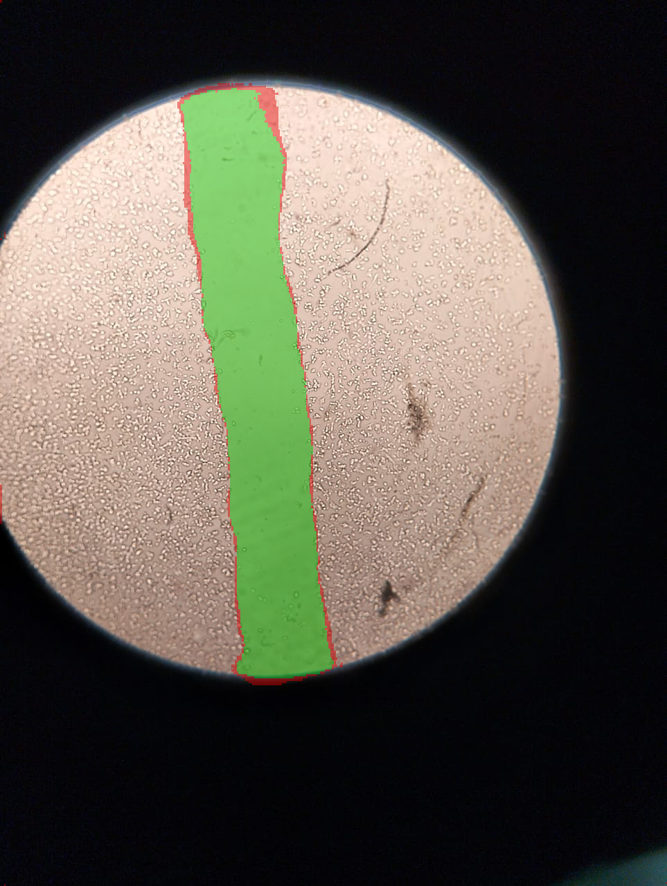
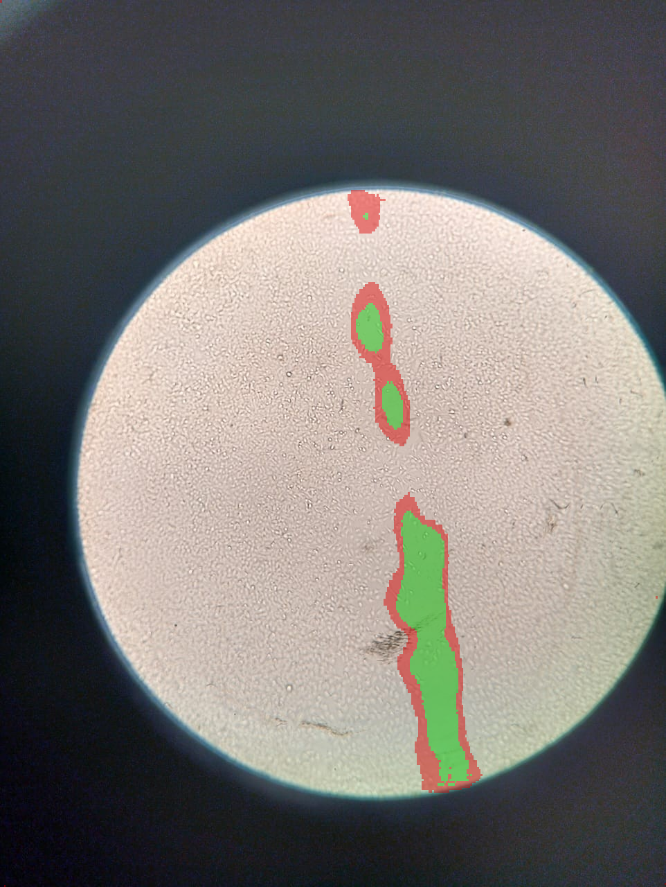

Rapport de Projet de Fin d'Année (PFA)
Titre : Segmentation automatique et suivi cinétique de plaies (scratch assay) par
deep learning, avec interprétation assistée par LLM (RAG)

Parcours IA&DS

À COMPLÉTER PAR L'ÉTUDIANT AVANT SOUMISSION : nom, prénom, établissement,
encadrant(s), année universitaire, logo de l'établissement (page de garde).

---

> Note de méthode (à supprimer avant soumission) : ce brouillon est rédigé
> directement à partir du code, des tests et du `README.md` du projet — aucun
> chiffre, résultat ou architecture n'est inventé. Trois choses restent à
> votre charge avant de rendre le rapport : (1) les captures d'écran de
> l'application (marquées `[CAPTURE D'ÉCRAN]` ci-dessous), (2) les auteurs des
> articles cités en bibliographie (le corpus du projet ne stocke que
> titre/année/résumé, pas les auteurs — à récupérer sur Google
> Scholar/PubMed/arXiv avant de mettre en forme IEEE/APA), et (3) les éléments
> propres à votre parcours (dates, encadrant, contexte de stage/cours).

---

## Introduction générale

Le suivi de la cicatrisation cellulaire in vitro repose largement sur le
*scratch assay* (ou *wound healing assay*) : une rayure est créée dans un tapis
confluent de cellules, puis sa refermeture est observée au microscope à
plusieurs instants. La mesure de la surface non colonisée à chaque instant
permet de quantifier la vitesse de migration cellulaire — un indicateur utilisé
aussi bien en recherche fondamentale (mécanismes de migration) qu'en criblage
de molécules thérapeutiques.

En pratique, cette mesure est aujourd'hui le plus souvent réalisée
manuellement : un opérateur trace au trait le contour de la zone non colonisée
sur chaque image. Cette méthode est lente, difficilement reproductible d'un
opérateur à l'autre, et devient un goulot d'étranglement dès qu'un laboratoire
doit traiter un grand nombre d'images ou de conditions expérimentales.

**Problématique.** Peut-on automatiser cette mesure par apprentissage profond
de façon suffisamment fiable pour remplacer le tracé manuel, et ce gain
justifie-t-il la complexité supplémentaire d'un modèle de deep learning par
rapport à une méthode de traitement d'image plus classique ? Et au-delà de la
mesure elle-même, un assistant conversationnel (LLM) peut-il aider un
biologiste à interpréter ces résultats à la lumière de la littérature
scientifique, sans jamais se substituer aux mesures ni inventer des données ?

**Objectifs du projet.**
1. Construire un pipeline de segmentation automatique de plaie par deep
   learning (U-Net + encodeur pré-entraîné), évalué rigoureusement sur un jeu
   de test indépendant.
2. Comparer ce modèle à une méthode de traitement d'image classique
   (seuillage sur texture), pour objectiver l'apport réel du deep learning.
3. Construire une application utilisable par un biologiste (interface
   Streamlit) intégrant la mesure automatique, le suivi temporel de la
   cicatrisation, une estimation de confiance de la prédiction par ensemble
   de modèles, et un résumé scientifique généré par LLM appuyé sur une base
   documentaire (RAG — *Retrieval-Augmented Generation*).
4. Garantir que la partie génération de texte par LLM ne fabrique jamais de
   chiffres ni de citations scientifiques inexistantes — un risque connu des
   modèles de langage, traité ici comme une exigence de fiabilité à part
   entière, pas comme un détail d'implémentation.

**Méthodologie.** Le projet suit une démarche empirique et itérative : chaque
choix (architecture, méthode de comparaison, méthode d'ensemble, prompt du
LLM, contenu de la base documentaire) est validé par une mesure chiffrée
avant d'être conservé, et les résultats négatifs (ce qui n'a pas fonctionné)
sont documentés au même titre que les résultats positifs plutôt que d'être
passés sous silence.

**Structure du rapport.** Le chapitre 1 situe le projet par rapport à la
littérature existante sur le scratch assay et sa quantification automatique.
Le chapitre 2 précise le problème, les données et l'architecture générale du
système. Le chapitre 3 détaille les choix d'implémentation. Le chapitre 4
présente l'évaluation quantitative complète et l'analyse critique des
résultats. Le chapitre 5 conclut et ouvre sur les perspectives d'amélioration.

---

## Chapitre 1 : État de l'art / Revue bibliographique

### 1.1 Concepts de base mobilisés

**Apprentissage supervisé — segmentation sémantique.** La tâche centrale du
projet est une segmentation binaire (pixel « plaie » / pixel « tapis
cellulaire ») apprise par apprentissage supervisé à partir d'exemples annotés
manuellement. Contrairement à une classification d'image entière, la
segmentation sémantique produit une prédiction par pixel, ce qui permet de
calculer directement une surface.

**Transfer learning.** Le modèle utilise un encodeur pré-entraîné sur
ImageNet (une tâche de classification d'images naturelles, sans rapport
apparent avec la microscopie cellulaire) plutôt qu'un entraînement entièrement
« from scratch ». Cette pratique, largement documentée dans la littérature de
segmentation d'images biomédicales (voir 1.3), permet d'obtenir de bonnes
performances même avec un jeu de données d'entraînement réduit — le cas ici,
avec seulement 68 images d'entraînement (voir Chapitre 2).

**Architecture encodeur-décodeur (U-Net).** Le U-Net (Ronneberger et al.,
2015) est l'architecture de référence pour la segmentation d'images
biomédicales : un chemin contractant (encodeur) capture le contexte global de
l'image, un chemin symétrique expansif (décodeur) restitue une localisation
précise, avec des connexions résiduelles (*skip connections*) entre les deux
qui préservent le détail spatial perdu par les convolutions successives de
l'encodeur.

**Méthodes d'ensemble et incertitude.** Le projet combine plusieurs modèles
indépendants par vote majoritaire pixel par pixel (voir Chapitre 3), une
technique classique de réduction de variance en apprentissage automatique :
les erreurs propres à un seul modèle (initialisation, bruit d'entraînement)
sont filtrées, sans propager les faux positifs isolés d'un modèle unique. Le
désaccord entre modèles sert par ailleurs de signal d'incertitude par pixel,
une approche documentée dans la littérature sur la quantification
d'incertitude en imagerie médicale (voir 1.2).

**Retrieval-Augmented Generation (RAG).** La partie assistant conversationnel
du projet combine un grand modèle de langage (LLM) avec une base documentaire
interrogée par similarité sémantique : plutôt que de laisser le LLM répondre
uniquement à partir de ses connaissances internes (risque d'information
obsolète ou inventée), la réponse est appuyée sur des extraits d'articles
scientifiques effectivement récupérés pour la question posée.

### 1.2 Le scratch assay et sa quantification : panorama des approches

La base documentaire constituée pour ce projet (voir aussi Chapitre 3, base du
RAG) couvre 48 articles scientifiques sélectionnés manuellement, organisés en
plusieurs catégories qui structurent naturellement cet état de l'art :

**Principes, protocole et limites du scratch assay.** Plusieurs revues
récentes (2021-2026) rappellent que le scratch assay, malgré sa simplicité et
son faible coût, souffre d'une variabilité opérateur-dépendante importante
(largeur et régularité de la rayure) et ne mesure que la migration collective
planaire — il ne reproduit pas les processus inflammatoires, vasculaires ou
matriciels d'une cicatrisation in vivo. Des dispositifs matériels ont été
proposés pour standardiser la création de la rayure (systèmes semi-automatisés,
plateformes robotisées open-source, dispositifs magnétiques ou
microfluidiques), une piste complémentaire — et non concurrente — de
l'automatisation de l'analyse d'image visée par ce projet.

**Analyse d'image classique.** Avant l'essor du deep learning, la
quantification du scratch assay reposait sur des outils de traitement d'image
classique : seuillage, filtrage morphologique, transformées de texture. Le
plugin ImageJ *Wound Healing Size Tool* et l'outil *TScratch* (transformée en
curvelets) en sont des exemples représentatifs, tout comme *Fiji*, plateforme
généraliste d'analyse d'image biologique. Ces outils restent largement utilisés
en laboratoire pour leur simplicité, mais nécessitent un réglage manuel de
paramètres et sont sensibles aux variations d'éclairage — une limite
directement mise en évidence dans ce projet (voir Chapitre 4, analyse
d'erreur par catégorie).

**Automatisation par analyse d'image « classique » avancée.** De nombreux
travaux proposent des pipelines automatisés sans deep learning : seuillage
adaptatif combiné à des descripteurs de texture (GLCM), flot optique pour
quantifier la direction de migration, transformée par ensembles de niveaux
(*level-set*) pour détecter le contour en conditions de faible contraste,
outils dédiés en Python (*WoundPy*) ou logiciels avec interface graphique
(*AIM*). Ces approches confirment l'intérêt d'automatiser la mesure, mais
restent, comme la méthode classique retenue pour la comparaison de ce projet,
sensibles aux conditions d'acquisition.

**Segmentation par deep learning.** Plusieurs études appliquent directement le
U-Net (ou ses variantes U-Net++, Attention U-Net) au scratch assay. Un
comparateur direct particulièrement pertinent pour ce projet rapporte un
coefficient de Dice de 0,958 à 0,968 sur plus de 400 images avec un U-Net
« classique » entraîné sur un jeu de données propre au laboratoire — à mettre
en regard du Dice de 0,882 obtenu ici sur seulement 97 images (voir Chapitre 4,
discussion du benchmark). Un second comparateur, appliqué à des micrographies
de cellules souches mésenchymateuses (modalité d'imagerie proche — microscopie
en contraste de phase — mais pas un scratch assay), obtient un Dice de 0,876,
très proche du résultat de ce projet malgré un domaine légèrement différent.
Ces deux points de comparaison montrent que le Dice obtenu ici est cohérent
avec l'état de l'art pour un jeu de données de cette taille, sans pour autant
atteindre les meilleurs résultats obtenus sur des jeux de données nettement
plus volumineux.

**Métriques d'évaluation.** Au-delà du choix du modèle, la littérature met en
garde contre une évaluation naïve de la segmentation : le cadre *Metrics
Reloaded* recommande de choisir les métriques en fonction du problème plutôt
que par habitude, et l'article introduisant la mesure *clDice* propose une
métrique topologique spécifiquement conçue pour les structures fines et
allongées — une géométrie directement comparable à celle de la plaie étudiée
ici, dont les deux extrémités sont, empiriquement, la principale source
d'instabilité de la distance de Hausdorff mesurée dans ce projet (voir
Chapitre 4).

**Estimation d'incertitude par ensemble de modèles.** La littérature sur la
quantification d'incertitude en imagerie médicale par deep learning documente
les ensembles de modèles indépendants comme une approche state-of-the-art pour
produire une carte de confiance par pixel, complémentaire à la seule
prédiction binaire — directement en écho avec la carte de confiance construite
dans ce projet à partir de 4 modèles indépendants (voir Chapitre 3 et 4).

**Analyse temporelle / cinétique.** Peu de travaux couvrent spécifiquement le
suivi temporel multi-points de la fermeture (par opposition à une mesure
« avant/après »). Un article récent (2025) combine segmentation par U-Net++ et
modélisation temporelle de la trajectoire de fermeture (forêts aléatoires,
ARIMA, réseau convolutif temporel) — une approche plus ambitieuse que le
présent projet sur le plan de la modélisation temporelle, mais qui confirme la
pertinence de coupler segmentation et suivi cinétique.

### 1.3 Justification de l'approche adoptée

Trois choix structurants du projet sont directement justifiés par cette revue :

1. **U-Net + encodeur pré-entraîné** plutôt qu'une architecture entraînée from
   scratch : cohérent avec la pratique dominante de la littérature en imagerie
   biomédicale à petit jeu de données, et avec le résultat direct obtenu ici
   (Dice 0,882 avec seulement 68 images d'entraînement).
2. **Conserver une baseline classique** (seuillage sur texture) plutôt que de
   supposer a priori la supériorité du deep learning : la littérature montre
   que les méthodes classiques restent compétitives dans certaines conditions
   et permettent de mesurer objectivement l'apport réel du deep learning (voir
   Chapitre 4).
3. **RAG plutôt que LLM seul** pour la partie interprétation : la littérature
   sur les LLM documente largement le risque de fabrication d'information
   (« hallucination ») — un risque d'autant plus critique dans un contexte
   scientifique. Le RAG permet d'ancrer la réponse du LLM sur des extraits
   réellement récupérés, mais ne l'élimine pas entièrement (voir Chapitre 3,
   fiabilité de la génération), ce qui a nécessité une méthodologie de test
   dédiée développée spécifiquement pour ce projet.

---

## Chapitre 2 : Analyse et spécifications du projet

### 2.1 Définition du problème

Étant donné une série d'images de microscopie d'un même scratch assay prises à
différents instants, produire automatiquement :
1. le masque binaire de la zone non colonisée (la « plaie ») pour chaque
   image ;
2. la surface correspondante (en pixels², convertible en cm² si un ratio de
   calibration est fourni) ;
3. le pourcentage de fermeture par rapport à l'instant initial, et la vitesse
   de fermeture entre chaque paire d'instants ;
4. un résumé scientifique en langage naturel de cette cinétique, replacé dans
   le contexte de la littérature scientifique pertinente.

### 2.2 Objectifs fonctionnels

- Segmenter une image de scratch assay et en extraire la surface non
  colonisée.
- Permettre une correction manuelle du masque (suppression de fragments,
  correction au pinceau) lorsque la prédiction automatique est imparfaite.
- Suivre plusieurs images d'une même série temporelle et calculer la
  cinétique de fermeture.
- Comparer un masque prédit à un masque de référence (métriques de qualité).
- Générer un résumé scientifique de la cinétique observée, appuyé sur une
  base documentaire, et permettre une conversation libre avec un assistant
  IA sur ce même résultat.
- Fournir une estimation de confiance de la prédiction (option d'ensemble de
  modèles), pour signaler à l'utilisateur les zones de désaccord entre
  modèles plutôt que de présenter un résultat unique sans indication de
  fiabilité.

### 2.3 Objectifs non fonctionnels

- **Reproductibilité** : split d'entraînement/validation/test fixé par graine
  aléatoire, expériences tracées (MLflow), résultats de robustesse
  inter-seed mesurés plutôt que supposés.
- **Fonctionnement local / sans dépendance externe payante** : le LLM tourne
  en local via Ollama, sans appel à une API propriétaire facturée à l'usage —
  contrainte pertinente pour un usage académique ou en laboratoire sans
  budget API dédié.
- **Fiabilité de la génération de texte** : aucune valeur numérique
  présentée au biologiste ne doit être calculée ou modifiée par le LLM — un
  objectif non fonctionnel central du projet, traité comme une contrainte
  d'architecture (voir Chapitre 3) plutôt que comme une simple bonne pratique
  de prompt.
- **Utilisabilité** : interface graphique (Streamlit) ne nécessitant aucune
  compétence en programmation de l'utilisateur final (biologiste).
- **Portée clairement délimitée** : outil de quantification pour la
  recherche in vitro, explicitement non destiné à un usage diagnostique ou
  clinique (voir Chapitre 5, limites).

### 2.4 Jeu de données

- **Source** : 97 images de microscopie de scratch assay.
- **Annotation** : chaque image est annotée manuellement par un contour tracé
  à la main directement sur la photo (pas un masque binaire directement
  exploitable).
- **Préparation** : un script dédié reconstruit les masques binaires à partir
  de ces contours tracés à la main : détection du trait par couleur/teinte,
  pontage des discontinuités du trait (effacé par endroits à cause de la
  compression JPEG), fermeture morphologique sur les bords d'image, puis
  remplissage par *flood-fill* de la zone délimitée.
- **Nettoyage** : une image est exclue du jeu de données final, son tracé
  manuel étant incomplet même après ce traitement.
- **Split** : séparation reproductible (graine fixée) en 68 images
  d'entraînement, 14 de validation, 14 de test. Le jeu de test est tenu à
  l'écart aussi bien de l'entraînement que de la sélection du meilleur
  modèle (contrairement au jeu de validation), pour que le score final soit
  une estimation non biaisée de la capacité de généralisation.
- **Variables/format** : images RGB de microscopie (résolution native
  variable selon l'image), masques binaires de même résolution ; les
  métadonnées associées à un suivi temporel sont le temps (en heures) et
  l'identifiant d'image.

### 2.5 Méthode d'analyse (pipeline global)

```
Image de plaie
      |
Segmentation automatique (U-Net + ResNet34)
      |
Quantification de la surface (px² / cm²)
      |
Suivi temporel (0 h / 24 h / 48 h / ...)
      |
Analyse de la cinétique de fermeture
      |
Interprétation scientifique (LLM + RAG sur la littérature)
```

Le pipeline est volontairement stratifié en couches indépendantes, chacune
responsable d'un seul type de calcul :

1. **Couche vision** : produit un masque de segmentation, entièrement
   déterministe une fois le modèle entraîné, évaluée par des métriques
   d'image classiques (Chapitre 4).
2. **Couche quantification** : transforme ce masque en grandeurs numériques
   (surface, %, vitesse), calculées uniquement en code (Python), jamais par
   le LLM.
3. **Couche interprétation** : reçoit ces grandeurs déjà calculées en entrée
   et les met en forme/contextualise, sans jamais recalculer ni halluciner de
   nouvelles valeurs (voir Chapitre 3.4).
4. **Couche présentation** : interface Streamlit reliant les trois couches
   précédentes pour l'utilisateur final.

`[CAPTURE D'ÉCRAN : schéma d'architecture à refaire en diagramme (boîtes/flèches) à partir du pipeline ci-dessus, pour le rapport final]`

---

## Chapitre 3 : Conception et implémentation

### 3.1 Architecture du système

Le projet est organisé en quatre modules principaux :

| Module | Rôle | Fichiers clés |
|---|---|---|
| `src/` | Préparation des données, modèle, entraînement, évaluation, mesure, cinétique | `model.py`, `train.py`, `dataset.py`, `evaluate.py`, `measure.py`, `kinetics.py`, `baseline.py`, `ensemble.py` |
| `chatbot/` | Assistant IA (RAG) : recherche documentaire, génération de résumé, détection de citations fabriquées | `chatbot.py`, `index_articles.py`, `evaluate_retrieval.py` |
| `app.py` | Interface utilisateur (Streamlit) | — |
| `tests/` | Tests automatisés (unitaires + réels contre le LLM) | `test_measure.py`, `test_metrics.py`, `test_ensemble.py`, `test_chatbot_*.py` |

L'entraînement et le suivi d'expériences utilisent MLflow (métriques par
époque, checkpoints et logs sauvegardés comme artefacts pour chaque run), avec
une intégration continue (tests automatisés) sur GitHub Actions à chaque
modification du code.

### 3.2 Algorithme d'apprentissage et paramètres

**Modèle** : U-Net avec encodeur ResNet34 pré-entraîné sur ImageNet
(bibliothèque `segmentation_models_pytorch`), une seule classe de sortie
(plaie / non-plaie), 3 canaux d'entrée (RGB) :

```python
def build_model(encoder_name="resnet34", encoder_weights="imagenet"):
    return smp.Unet(
        encoder_name=encoder_name,
        encoder_weights=encoder_weights,
        in_channels=3,
        classes=1,
    )
```

**Entraînement** (`src/train.py`) :

| Hyperparamètre | Valeur |
|---|---:|
| Époques (maximum) | 60 |
| Taille de batch | 4 |
| Taille d'image | 384 × 384 |
| Taux d'apprentissage initial | 1×10⁻⁴ |
| Époques encodeur gelé (warmup) | 5 |
| Patience (early stopping sur Dice val.) | 15 |
| Fonction de perte | Dice + BCE (voir ci-dessous) |
| Ordonnanceur de LR | `ReduceLROnPlateau` |

Stratégie en deux phases : l'encodeur pré-entraîné est d'abord gelé pendant 5
époques (seul le décodeur apprend, pour ne pas détruire les poids ImageNet
avec un signal de gradient encore bruité), puis dégelé avec un taux
d'apprentissage réduit d'un facteur 10 pour affiner l'ensemble du réseau.

**Fonction de perte (Dice + BCE)** — combine une perte de recouvrement (Dice,
adaptée aux masques très déséquilibrés fond/plaie) et une perte de
classification pixel par pixel (entropie croisée binaire) :

```python
class DiceBCELoss(torch.nn.Module):
    def __init__(self):
        super().__init__()
        self.bce = torch.nn.BCEWithLogitsLoss()

    def forward(self, logits, target):
        bce = self.bce(logits, target)
        probs = torch.sigmoid(logits)
        pred = probs.flatten(1)
        tgt = target.flatten(1)
        intersection = (pred * tgt).sum(1)
        dice = (2 * intersection + EPS) / (pred.sum(1) + tgt.sum(1) + EPS)
        return bce + (1 - dice.mean())
```

### 3.3 Prétraitement et préparation des données

- **Augmentation de données** (bibliothèque `albumentations`, à
  l'entraînement uniquement) : recadrage aléatoire, retournements, ajout de
  bruit — pour compenser la taille réduite du jeu d'entraînement (68 images).
- **Prétraitement optionnel côté application** : débruitage, correction de
  champ plat (*flat-field*), égalisation d'histogramme adaptative (CLAHE),
  activables par l'utilisateur avant prédiction.
- **Reconstruction des masques de vérité terrain** à partir des contours
  tracés à la main (voir 2.4).
- **Évaluation en résolution native** : le masque prédit (calculé sur
  l'image redimensionnée à la taille attendue par le réseau) est
  ré-suréchantillonné à la résolution originale avant comparaison — pour
  refléter exactement ce que voit l'utilisateur final dans l'application,
  plutôt qu'un score optimiste obtenu à basse résolution.

### 3.4 Fiabilité de la génération par LLM (RAG)

Ce point mérite une sous-section dédiée : c'est la contrainte de conception la
plus spécifique de ce projet, largement au-delà d'un simple appel à une API de
LLM.

**Architecture à deux appels séparés.** Le résumé scientifique de cinétique
est construit par **deux appels indépendants** au LLM local (Ollama, modèle
Mistral) :
1. Un premier appel reçoit uniquement les mesures déjà calculées par le
   pipeline (surface, %, vitesses par intervalle) — jamais d'extrait
   d'article.
2. Un second appel reçoit uniquement des extraits d'articles scientifiques
   pertinents — jamais aucune mesure.

Cette séparation rend la contamination croisée (le LLM confondant une vitesse
mesurée avec un chiffre lu dans un article de la base documentaire)
structurellement impossible, plutôt que simplement déconseillée par une
consigne de prompt.

**Calcul en Python, jamais par le LLM.** Toutes les valeurs numériques
présentées (moyennes, vitesses par intervalle, comparaison entre intervalles)
sont calculées par du code Python pur et injectées déjà calculées dans le
prompt ; le LLM n'a plus qu'à les recopier et les mettre en forme. Ce choix
résulte directement d'une observation empirique répétée au cours du projet :
un modèle de langage local de taille modeste (Mistral 7B) commet régulièrement
des erreurs lorsqu'on le laisse recalculer ou comparer des chiffres
lui-même — y compris lorsqu'un patron de phrase explicite lui est fourni pour
le faire (bornes d'intervalles inversées, signe négatif fabriqué ou omis). La
solution retenue n'a donc pas été de renforcer la consigne de prompt outre
mesure, mais d'éliminer la liberté de calcul du modèle : chaque phrase
comparative est entièrement pré-composée par du code Python, le LLM se
limitant à la recopier mot pour mot.

**Détection de citations fabriquées.** Un contrôle *a posteriori*, purement
programmatique, compare chaque titre d'article cité entre guillemets par le
LLM aux titres réellement retournés par la recherche documentaire pour cette
génération (comparaison approchée par distance d'édition, pour tolérer des
variantes mineures de recopie). Toute citation ne correspondant à aucun titre
réel est signalée à l'utilisateur.

**Méthodologie de test dédiée.** Chaque modification du prompt ou du contenu
de la base documentaire est validée par un test d'isolation : plusieurs
générations réelles sont produites avant et après la modification et
comparées, plutôt que de supposer qu'une modification du texte d'instruction
suffit à changer le comportement du modèle. Cette méthodologie a permis
d'identifier et de corriger plusieurs défauts qui n'auraient pas été détectés
par une simple relecture du prompt (voir Chapitre 4.4).

Un exemple récent illustre une limite structurelle de cette approche : le
prompt de mise en contexte bibliographique a été reformulé pour toujours
situer la problématique générale (plutôt que de se contenter d'un « le
corpus ne permet pas de conclure »), sans jamais comparer directement un
chiffre de l'expérience à celui d'un article. Testé en isolation, ce nouveau
prompt s'est révélé meilleur en moyenne, mais n'a pas éliminé un défaut déjà
connu ailleurs dans le projet : citer une source par sa position (« la
première étude ») plutôt que par son titre. Plutôt que de continuer à
renforcer indéfiniment la consigne — au risque de déstabiliser d'autres
parties du prompt, comme observé à plusieurs reprises sur ce projet —, la
correction retenue est un contrôle programmatique après coup, déjà en place
pour ce même défaut sur un autre tour du prompt : la génération est
systématiquement relue par du code Python qui remplace toute référence
positionnelle par le vrai titre de l'article, avant tout affichage à
l'utilisateur. Ce choix illustre le principe déjà énoncé plus haut : quand un
prompt seul ne garantit pas un comportement de façon fiable, la solution
retenue dans ce projet est un contrôle déterministe en aval, jamais une
consigne de prompt toujours plus longue.

Un second test d'usage réel, sur ce même écran, a révélé un autre défaut :
le paragraphe de mise en contexte présentait parfois des conclusions
biologiques précises (« les cellules migrent de façon coordonnée ») comme des
faits généraux acquis, alors que les extraits ne font que proposer des
méthodes pour étudier ce genre de comportement — avec un risque concret de
laisser croire que l'application mesure elle-même la trajectoire ou la
directionnalité des cellules, alors qu'elle ne mesure que la surface de la
plaie et son évolution temporelle. Le prompt a été à nouveau ajusté (décrire
ce que les travaux *proposent*, jamais ce qu'ils *établissent* comme fait
biologique général, avec un rappel explicite du périmètre de mesure de
l'application) et retesté en isolation : amélioration nette sur ce défaut
précis, sans régression nouvelle par rapport aux limites déjà connues et
documentées de ce modèle local. Ce second cycle confirme, sur un exemple de
plus, que la fiabilité de cette section ne peut être établie qu'en observant
des générations réelles répétées, jamais en supposant qu'un ajustement de
prompt, aussi raisonnable paraisse-t-il à la lecture, produit l'effet
recherché du premier coup.

`[CAPTURE D'ÉCRAN : interface Streamlit — onglet "Analyse d'une image" et onglet "Suivi de cicatrisation" avec résumé LLM + chat RAG]`

### 3.5 Environnement et outils

Python, avec les bibliothèques principales suivantes : `torch` /
`torchvision`, `segmentation-models-pytorch`, `albumentations`, `opencv-python`,
`streamlit` (+ `streamlit-drawable-canvas`, `streamlit-image-coordinates`),
`chromadb` et `rank_bm25` (recherche documentaire), `ollama` (client LLM
local), `mlflow` (suivi d'expériences), `pytest` (tests).

---

## Chapitre 4 : Évaluation et expérimentation

### 4.1 Métriques d'évaluation utilisées

Pour une tâche de segmentation binaire, l'accuracy pixel par pixel est peu
informative (les masques sont très déséquilibrés : la plaie occupe une faible
part de l'image) et n'a volontairement pas été retenue comme métrique
principale. Les métriques utilisées sont :

- **Dice** (équivalent du F1-score pour des masques binaires) et **IoU**
  (Intersection-over-Union) — métriques de recouvrement, les plus pertinentes
  pour ce projet.
- **Precision** et **Recall** — pour caractériser le type d'erreur dominant
  (sur-segmentation vs sous-segmentation).
- **Distance de Hausdorff normalisée** (rapportée à la diagonale de l'image,
  pour rester comparable entre images de résolutions différentes) — métrique
  de pire cas, sensible à un seul point de contour mal placé.
- **Erreur de surface** (absolue en px² et relative en %) — la métrique la
  plus directement interprétable pour un biologiste, puisqu'elle porte sur la
  grandeur finalement utilisée (surface de plaie).

### 4.2 Résultats obtenus

**Comparaison U-Net vs baseline classique** (14 images de test, jamais vues à
l'entraînement) :

| Méthode | Dice | IoU | Precision | Recall | Hausdorff normalisé | MAE surface (px²) | Erreur de surface relative |
|---|---:|---:|---:|---:|---:|---:|---:|
| Texture + Otsu (baseline) | 0,576 | 0,448 | 0,558 | 0,817 | 0,204 | 210 243 | 404,9 % |
| **U-Net + ResNet34** | **0,882** | **0,796** | **0,852** | 0,929 | 0,323 | **8 538** | **15,9 %** |

Le U-Net domine largement sur les métriques de recouvrement et surtout sur
l'erreur de surface (15,9 % contre 405 % pour la baseline). Le Hausdorff
normalisé du U-Net est en revanche plus élevé (moins bon) que celui de la
baseline malgré un Dice très supérieur — un résultat contre-intuitif rapporté
sans le masquer, discuté en 4.4.

**Test-Time Augmentation (TTA)** — moyenner les probabilités prédites sur 4
versions retournées de l'image avant seuillage fait chuter le Hausdorff
normalisé de 0,323 à 0,043, confirmant que le Hausdorff élevé provient
d'artefacts de contour isolés, pas d'un problème de recouvrement global. Ce
gain n'est cependant pas généralisable à toutes les métriques : le Dice reste
quasi inchangé (0,882 → 0,886) et l'erreur de surface se dégrade légèrement
(15,9 % → 16,9 %). La TTA améliore donc spécifiquement la stabilité du
contour, sans réduction de l'erreur de surface — c'est l'ensemble de modèles
(ci-dessous) qui obtient la meilleure performance globale parmi les variantes
évaluées.

**Ensemble de 4 modèles + carte de confiance** — les 4 modèles indépendants
déjà entraînés (le run canonique + les 3 graines de l'étude de robustesse)
sont combinés par vote majoritaire pixel par pixel ; le nombre de modèles en
désaccord à chaque pixel fournit une carte de confiance exploitable
directement par l'utilisateur :

| Métrique | Modèle unique | Ensemble (4 modèles) |
|---|---:|---:|
| Dice | 0,882 | **0,893** |
| IoU | 0,796 | **0,812** |
| Precision | 0,852 | **0,881** |
| Recall | 0,929 | 0,915 |
| Hausdorff normalisé | 0,323 | **0,038** |
| Erreur de surface relative | 15,9 % | **12,2 %** |

La carte de confiance n'est pas un simple gadget visuel : la corrélation
mesurée entre le pourcentage de zone en désaccord entre modèles et le Dice par
image est de −0,751 — les images où les modèles divergent le plus sont
statistiquement celles où l'ensemble se trompe le plus.

**Illustration concrète (deux cas réels du jeu de test).** Pour rendre ce
chiffre tangible, deux images de test aux profils opposés sont comparées
ci-dessous (carte de confiance : vert = les 4 modèles d'accord, rouge =
désaccord partiel) :

| | Image 6 (faible incertitude) | Image 91 (forte incertitude) |
|---|---|---|
| Zone incertaine | 7,1 % | **46,5 %** (> seuil d'alerte de l'application, 25 %) |
| Dice | 0,951 | 0,824 |
| Erreur de surface | 5,0 % | 21,4 % |





Sur l'image 6, une plaie franche et continue : les 4 modèles s'accordent
presque partout, la zone incertaine reste sous les 10 % et le Dice dépasse
0,95. Sur l'image 91, une plaie quasi refermée et fragmentée en plusieurs
îlots disjoints : les modèles divergent sur près de la moitié de la zone
détectée, l'application déclenche son avertissement de vérification manuelle,
et le Dice chute à 0,824 — exactement la relation statistique mesurée
ci-dessus, observée ici sur un exemple concret plutôt que sur une moyenne.
Ce contraste illustre l'utilité pratique de l'indicateur pour le biologiste :
il ne se contente pas d'annoncer une surface, il signale aussi quand cette
surface mérite une vérification visuelle avant d'être réutilisée.

`[CAPTURE D'ÉCRAN : ce même contraste directement dans l'onglet "Analyse
d'une image" de l'application, case "Estimation de confiance" cochée, pour
montrer l'indicateur "Zone incertaine" et l'avertissement en contexte]`

**Robustesse inter-seed** — le même protocole d'entraînement a été répété sur
3 graines aléatoires indépendantes pour vérifier que le résultat ne tient pas
à un split ou une initialisation favorable :

| Seed | Dice | IoU | Erreur de surface | Hausdorff normalisé |
|---|---:|---:|---:|---:|
| 42 | 0,880 | 0,791 | 16,1 % | 0,083 |
| 123 | 0,904 | 0,828 | 7,2 % | 0,131 |
| 2026 | 0,892 | 0,809 | 8,8 % | 0,032 |
| **moyenne ± écart-type** | **0,892 ± 0,009** | **0,809 ± 0,015** | **10,7 % ± 3,9 %** | **0,082 ± 0,040** |

Le Dice est stable d'une graine à l'autre (écart-type de 0,009) — la
performance n'est pas un coup de chance lié au split — tandis que le Hausdorff
varie fortement (presque ×4 entre graines), confirmant qu'il ne doit pas être
lu comme un score de qualité stable pour cette tâche.

### 4.3 Comparaison de différents modèles/paramètres et significativité statistique

Au-delà de la comparaison de moyennes, un test des rangs signés de Wilcoxon
(non paramétrique, adapté à un petit échantillon) a été appliqué aux paires
**(U-Net, baseline classique)** sur le Dice et sur l'IoU de chacune des 14
images de test (comparaison appariée image par image, script
`src/statistical_comparison.py`), complété par un intervalle de confiance
bootstrap (10 000 ré-échantillonnages) sur la différence moyenne :

| Métrique | Moyenne U-Net | Moyenne baseline | Diff. moyenne | U-Net meilleur sur | p (Wilcoxon) | IC bootstrap 95 % |
|---|---:|---:|---:|---:|---:|---:|
| Dice | 0,882 | 0,576 | +0,307 | 14/14 images | 0,000122 | [+0,183 ; +0,448] |
| IoU | 0,796 | 0,448 | +0,348 | 14/14 images | 0,000122 | [+0,236 ; +0,470] |

Sur le Dice et sur l'IoU, le U-Net obtient un score supérieur à la baseline
classique sur les 14 images de test sans exception, ce qui produit le p le
plus faible que ce test puisse atteindre à cette taille d'échantillon
(largement < 0,05) : **la supériorité du U-Net sur la baseline classique**
(et non sur l'ensemble de modèles ou une autre variante) est statistiquement
significative sur cet échantillon. Cette comparaison ne porte que sur
U-Net vs baseline ; les gains de l'ensemble et de la TTA (4.2) sont rapportés
comme des moyennes sur le même jeu de test, sans test de significativité
dédié à ce stade. Réserve méthodologique : un échantillon de 14 images reste
petit pour généraliser au-delà de ce jeu de test précis — réserve que
l'étude de robustesse inter-seed (4.2, Dice = 0,892 ± 0,009 sur 3 graines)
vient partiellement contrebalancer, en montrant que le résultat ne tient pas
à un split ou une initialisation favorable.

Les comparaisons de paramètres/configurations réalisées sont : modèle unique
vs ensemble de 4 modèles (4.2), avec vs sans TTA (4.2), et robustesse sur 3
graines d'initialisation différentes (4.2) — un seul jeu d'hyperparamètres
d'entraînement (encodeur, taille d'image, taux d'apprentissage) a été exploré
à ce stade (voir Chapitre 5, perspectives).

### 4.4 Analyse critique des résultats

**Cas qualitatifs représentatifs** (figure dédiée, quatre cas : image
originale / vérité terrain / U-Net / baseline) : sur un cas de bonne
segmentation, les deux méthodes suivent le contour mais la baseline ajoute du
bruit ; sur un cas difficile, le U-Net reste précis quand la baseline se
fragmente ; sur un cas d'échec de la baseline (éclairage atypique, fond
grisâtre plutôt que rose), le U-Net suit correctement le contour quand la
baseline dérive et trace presque tout le pourtour du champ — illustrant
concrètement la fragilité d'une méthode de seuillage classique face à des
conditions d'acquisition variables.

**Analyse d'erreur quantitative par catégorie** — pour vérifier avec des
chiffres (pas seulement sur les cas illustrés) l'hypothèse de fragilité de la
baseline à l'éclairage, les images de test ont été croisées avec un critère
objectif de luminosité (z-score par rapport au dataset complet) :

| Éclairage (test, n) | Dice U-Net | Dice baseline |
|---|---:|---:|
| Normal (12) | 0,884 | 0,656 |
| Atypique (2) | 0,874 | **0,092** |

Sur les images à éclairage atypique, le U-Net reste stable quand la baseline
s'effondre — confirmant que cette fragilité est systématique, pas un exemple
isolé choisi après coup. **Avertissement méthodologique explicite** : avec
seulement 14 images de test, chaque catégorie ne contient que 1 à 13 images ;
ce tableau sert à confirmer une tendance déjà observée qualitativement, pas à
établir un résultat statistique à part entière.

**Cas limite documenté** : l'image obtenant le pire score des deux méthodes
correspond à la plus petite surface de plaie de tout le dataset (rang 1/97,
1,3 % du champ). Sur une structure aussi fine, quelques pixels d'écart de
contour suffisent à faire chuter fortement des métriques proportionnelles à la
surface (Dice/IoU) — une limite connue et mesurable sur les plaies quasi
refermées, partagée par les deux méthodes, et non un échec de généralisation
isolé.

**Mise en regard avec la littérature (Chapitre 1)** : le Dice de 0,882 obtenu
ici, sur seulement 97 images, est cohérent avec un comparateur indépendant sur
une modalité d'imagerie proche (Dice 0,876, cellules souches mésenchymateuses)
mais nettement inférieur à un comparateur direct sur scratch assay disposant
de plus de 400 images (Dice 0,958-0,968) — l'écart le plus plausible étant la
taille du jeu d'entraînement, pas un défaut d'architecture (voir Chapitre 5).

**Fiabilité de la génération par LLM (évaluation qualitative)** — au-delà des
métriques de segmentation, le projet a développé une méthodologie de test
spécifique pour la partie LLM/RAG : tests de régression exécutant de vraies
générations contre le modèle local et vérifiant que le texte produit contient
exactement les valeurs calculées par le pipeline et aucune valeur fabriquée
connue. Cette méthodologie a permis de détecter, au cours du développement,
plusieurs défauts non triviaux (confusion entre le taux d'un intervalle et la
vitesse moyenne globale, signe négatif fabriqué sur une vitesse pourtant
positive, bornes d'intervalle inversées) — chacun corrigé non pas en renforçant
la consigne donnée au modèle, mais en supprimant sa liberté de calcul sur le
point concerné (voir Chapitre 3.4). C'est une contribution méthodologique du
projet à part entière : la fiabilité d'un système LLM+RAG dans un contexte
scientifique ne peut pas être supposée à partir de la qualité apparente d'un
prompt, elle doit être mesurée par génération réelle répétée.

**Évaluation du retrieval documentaire (RAG)** — un benchmark reproductible
de questions représentatives associées manuellement à leur(s) article(s)
pertinent(s) donne un Recall@3 de 69,2 % et un MRR@10 de 0,562 sur le corpus
actuel (48 articles) : la recherche sémantique retrouve le bon article dans
le top 3 pour environ sept questions testées sur dix, avec une sensibilité
documentée à la formulation exacte de la question plutôt qu'à un simple écart
de langue français/anglais (voir Chapitre 5, perspectives).

---

## Chapitre 5 : Conclusion et perspectives

### 5.1 Principales réalisations

- Un pipeline complet de segmentation automatique de scratch assay (U-Net +
  ResNet34), évalué rigoureusement sur un jeu de test indépendant et jamais
  vu à l'entraînement, avec une amélioration statistiquement significative
  par rapport à une méthode classique de traitement d'image (p = 0,000122).
- Une étude de robustesse inter-seed et une méthode d'ensemble de modèles
  produisant à la fois de meilleures métriques et une carte de confiance par
  pixel exploitable directement par l'utilisateur final, illustrée
  concrètement sur des cas réels (Chapitre 4.2).
- Une application Streamlit complète intégrant mesure, suivi temporel,
  correction manuelle et interprétation assistée par LLM.
- Une architecture LLM/RAG conçue spécifiquement pour empêcher la fabrication
  de chiffres ou de citations scientifiques, validée par une méthodologie de
  test dédiée (génération réelle répétée, pas une simple relecture de
  prompt).

### 5.2 Difficultés rencontrées

- **Taille réduite du jeu de données** (97 images au total) : a orienté
  plusieurs choix de conception (transfer learning, augmentation de données
  forte, réserve méthodologique sur la portée des résultats statistiques).
- **Instabilité de la distance de Hausdorff**, initialement difficile à
  interpréter (le U-Net semblait moins bon que la baseline sur cette seule
  métrique) : résolue par une double investigation (Test-Time Augmentation,
  puis étude multi-seed) qui a permis d'attribuer cette instabilité à la
  géométrie fine de la plaie plutôt qu'à un défaut réel du modèle.
- **Fiabilité d'un LLM local de taille modeste** (Mistral 7B) sur des tâches
  de recopie/comparaison numérique : plusieurs itérations ont été nécessaires
  pour aboutir à une architecture qui élimine structurellement le risque de
  fabrication, une consigne de prompt seule s'étant révélée insuffisante à
  plusieurs reprises.
- **Sensibilité du retrieval documentaire à la formulation de la question**,
  en particulier pour des questions de comparaison quantitative (« mon Dice
  est-il faible comparé à d'autres études ? »), non résolue de façon
  entièrement satisfaisante à ce stade.

### 5.3 Perspectives d'évolution

- **Validation externe** : évaluer le modèle sur des images de scratch assay
  d'un autre laboratoire/microscope, pour démontrer une généralisation
  au-delà des conditions d'acquisition du jeu de données actuel.
- **Exploration d'hyperparamètres plus large** : un seul jeu d'hyperparamètres
  d'entraînement a été tracé à ce stade (encodeur, taille d'image, taux
  d'apprentissage) ; une recherche plus systématique permettrait de savoir si
  la configuration actuelle est déjà proche d'un optimum.
- **Comparaison architecturale** : confronter U-Net/ResNet34 à d'autres
  architectures de segmentation légères, pour distinguer l'apport du deep
  learning en général de celui de cette configuration précise.
- **Enrichissement du jeu de données** : élargir le nombre d'images
  annotées, en particulier sur les cas actuellement sous-représentés (plaies
  quasi refermées, éclairages atypiques).
- **Amélioration du retrieval documentaire** : un modèle d'embeddings
  multilingue plus grand, ou une recherche hybride mots-clés + embeddings
  (déjà testée côté retrieval seul, mais déstabilisant la génération du
  résumé en aval) sont des pistes déjà identifiées, chacune à valider par le
  même double protocole de test (benchmark de retrieval ET test d'isolation
  de génération).
- **Base documentaire recentrée par catégorie** : plutôt qu'un élargissement
  généraliste du corpus, cibler spécifiquement les catégories les plus
  utiles à l'interprétation d'un résultat de scratch assay (principe et
  méthodologie, quantification et analyse d'images, migration cellulaire,
  prolifération — pour éviter une lecture simpliste « fermeture = migration
  », cinétique de fermeture, facteurs expérimentaux pouvant expliquer un
  résultat inhabituel), pour que chaque référence retrouvée corresponde à une
  vraie question qu'un biologiste poserait sur son résultat, plutôt qu'une
  recherche générale sur la cicatrisation.

---

## Références bibliographiques

> À COMPLÉTER : les auteurs ne sont pas stockés dans la base documentaire du
> projet (seuls titre, année et résumé le sont) — à récupérer avant mise en
> forme définitive (style IEEE ou APA selon les consignes de l'établissement).
> La sélection ci-dessous couvre les catégories utilisées au Chapitre 1 ;
> l'intégralité du corpus (48 articles) est disponible dans
> `chatbot/articles_cicatrisation.json`.

1. Ronneberger, O. et al. « U-Net: Convolutional Networks for Biomedical
   Image Segmentation ». 2015.
2. « An automated in vitro wound healing microscopy image analysis approach
   utilizing U-net-based deep learning methodology ». 2024.
3. « Comparative Study of Deep Transfer Learning Models for Semantic
   Segmentation of Human Mesenchymal Stem Cell Micrographs ». 2025.
4. « TernausNet: U-Net with VGG11 Encoder Pre-Trained on ImageNet for Image
   Segmentation ». 2018.
5. « Embracing imperfect datasets: A review of deep learning solutions for
   medical image segmentation ». 2020.
6. « Metrics reloaded: recommendations for image analysis validation ». 2024.
7. « Metrics for evaluating 3D medical image segmentation: analysis,
   selection, and tool ». 2015.
8. « clDice — A Novel Topology-Preserving Loss Function for Tubular
   Structure Segmentation ». 2021.
9. « Studying Cell Migration (Random and Wound Healing) Parameters with
   Imaging and MATLAB Analysis ». 2023.
10. « Migratory Metrics of Wound Healing: A Quantification Approach for in
    vitro Scratch Assays ». 2018.
11. « Study of Wound Healing Dynamics by Single Pseudo-Particle Tracking in
    Phase Contrast Images Acquired in Time-Lapse ». 2021.
12. « Modeling epithelial wound closure dynamics with AI: A comparative
    study across cell types ». 2025.
13. « The In Vitro Wound-Scratch Assay: Applications, Technical Advances,
    and Limitations in Wound Healing Research ». 2026.
14. « Research Techniques Made Simple: Analysis of Collective Cell Migration
    Using the Wound Healing Assay ». 2017.
15. « TScratch: a novel and simple software tool for automated analysis of
    monolayer wound healing assays ». 2009.
16. « Fiji: an open-source platform for biological-image analysis ». 2012.
17. « AIM: A Computational Tool for the Automatic Quantification of Scratch
    Wound Healing Assays ». 2017.
18. « A Robust and Standardized Approach to Quantify Wound Closure Using the
    Scratch Assay ». 2023.
19. Buddenkotte, T. et al. « Calibrating Ensembles for Scalable Uncertainty
    Quantification in Deep Learning-based Medical Segmentation ». *Computers
    in Biology and Medicine*, 2023.
20. « A Review of Uncertainty Estimation and its Application in Medical
    Imaging ». 2023.

*(liste complète des 48 articles curés : `chatbot/articles_cicatrisation.json` ;
décisions de sélection tracées dans `chatbot/curation_log.csv`)*

Bibliothèques et outils logiciels : PyTorch, `segmentation-models-pytorch`,
Albumentations, OpenCV, Streamlit, ChromaDB, `rank_bm25`, Ollama, MLflow,
pytest.

---

## Annexes

### Annexe A — Instructions d'installation et de reproduction

```bash
pip install -r requirements.txt
python -m src.split_data                                             # (re)génère les splits
python -m src.train --run_name unet_resnet34_holdout                 # entraînement
python -m src.evaluate --run_name unet_resnet34_holdout --split test # évaluation U-Net
python -m src.evaluate_ensemble --split test                         # évaluation ensemble
python -m src.baseline --split test                                  # évaluation baseline
python -m src.statistical_comparison                                 # test de Wilcoxon
python -m src.error_analysis_figures                                 # figures d'analyse d'erreur
python -m src.error_analysis_categories                              # analyse d'erreur par catégorie
python -m src.plot_training_curves --run_name unet_resnet34_holdout  # courbes d'apprentissage
python -m chatbot.evaluate_retrieval                                 # benchmark de récupération du RAG
streamlit run app.py                                                  # lancer l'application
```

### Annexe B — Extraits de code importants

**Architecture du modèle** (`src/model.py`) :

```python
def build_model(encoder_name="resnet34", encoder_weights="imagenet"):
    return smp.Unet(
        encoder_name=encoder_name,
        encoder_weights=encoder_weights,
        in_channels=3,
        classes=1,
    )
```

**Métriques de segmentation** (`src/metrics.py`) :

```python
def iou_score(tp, fp, fn):
    return (tp + EPS) / (tp + fp + fn + EPS)

def dice_score(tp, fp, fn):
    return (2 * tp + EPS) / (2 * tp + fp + fn + EPS)
```

`[ANNEXE À COMPLÉTER : captures d'écran de l'application (les deux onglets),
tableaux/figures supplémentaires depuis outputs/figures/, éventuellement un
extrait du fichier de résultats bruts outputs/predictions/test_metrics.json]`

### Annexe C — Fichiers de résultats bruts disponibles

`outputs/predictions/test_metrics.json`,
`outputs/predictions/test_metrics_tta.json`,
`outputs/predictions/test_ensemble_metrics.json`,
`outputs/predictions/test_baseline_metrics.json`,
`outputs/predictions/test_statistical_comparison.json`,
`outputs/predictions/test_error_by_category.csv`,
`outputs/predictions/test_error_category_summary.csv`,
`outputs/figures/` (figures 1 à 5), `chatbot/retrieval_eval_results.json`.
